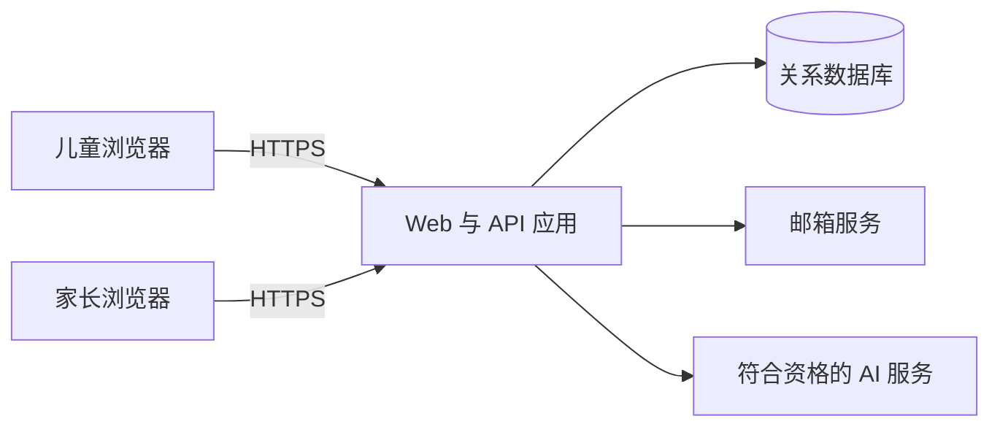
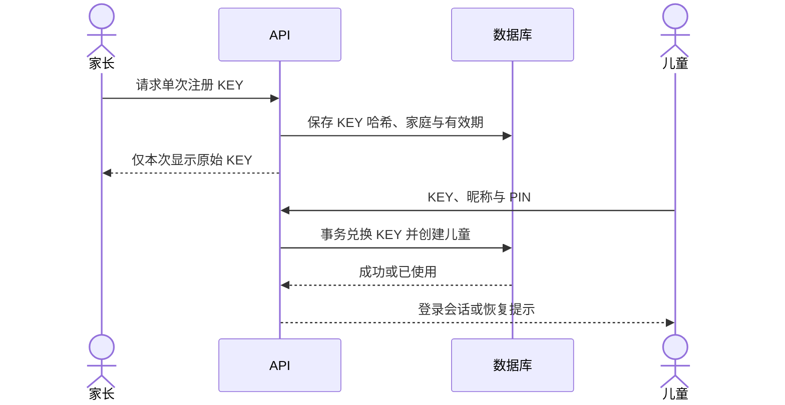
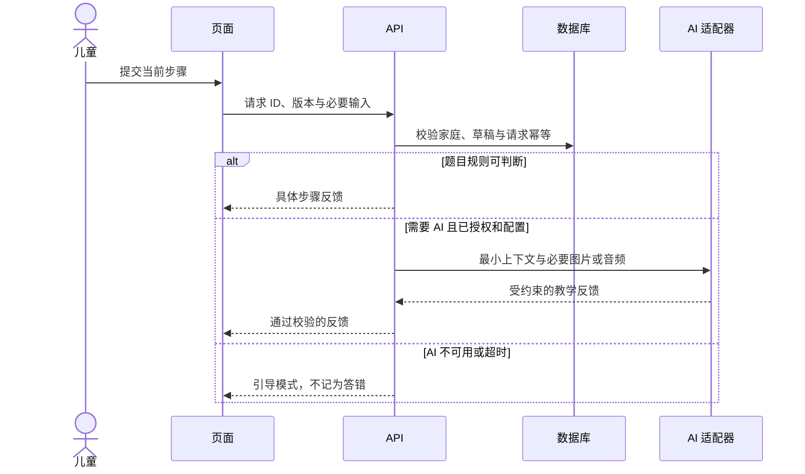
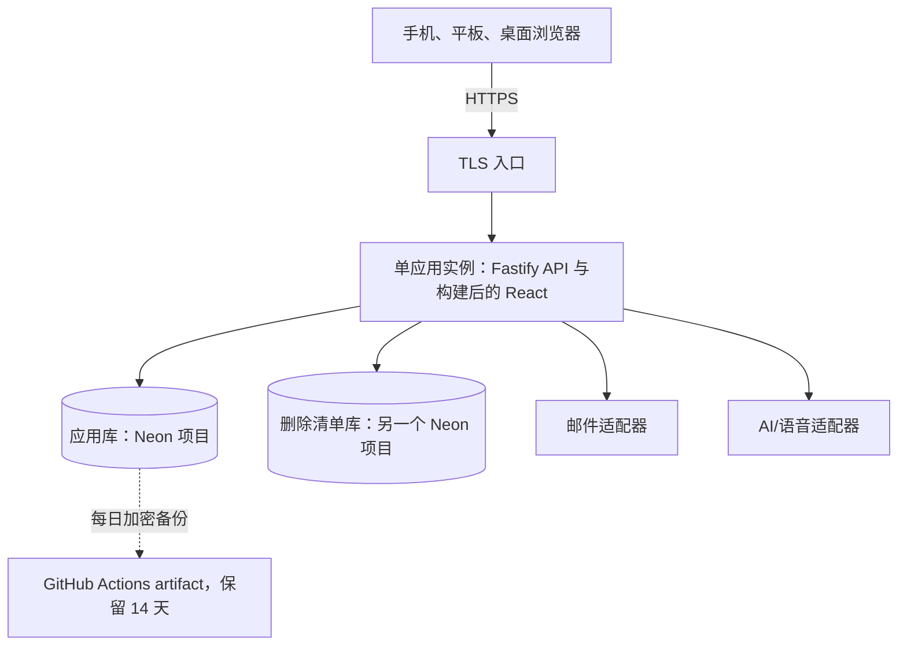
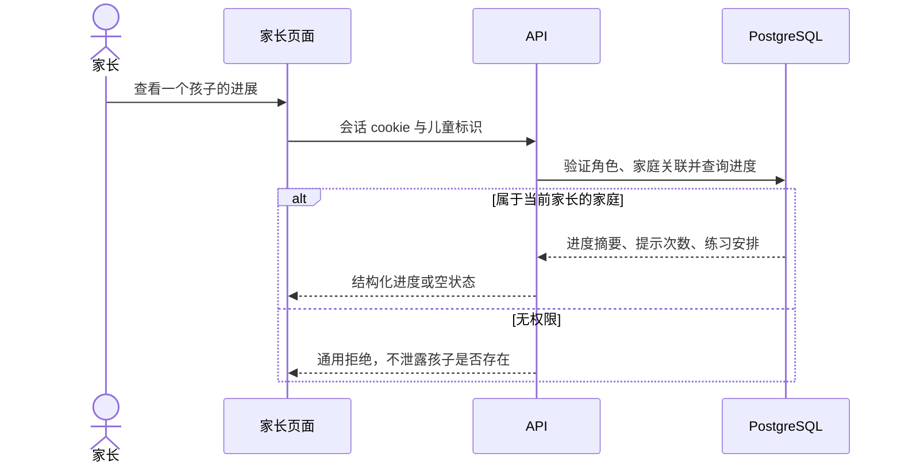

# 架构总览

用户已批准本架构。已确认选择与发布前待验证事项分别标注；批准设计不代表实际部署、服务可用性或外部资格已验证。

## 架构指标

| 指标       | 目标                                                              | 依据                                                                               |
| ---------- | ----------------------------------------------------------------- | ---------------------------------------------------------------------------------- |
| 规模       | 最多 10 家庭，约 3 儿童同时学习                                   | REQ-007                                                                            |
| 普通操作   | 健康状态下 2 秒内响应；统计口径待细化                             | 用户架构第一轮确认                                                                 |
| AI         | 健康状态下 5 秒内开始有效响应；10 秒未开始则提供引导模式选项      | 用户架构第一轮确认；不能把连接成功当成有效响应                                     |
| 网络       | 中国大陆可访问为发布硬条件；从真实大陆设备测量                    | 用户架构第一轮确认                                                                 |
| 托管成本   | 先验证免费候选；失败后使用用户提供的服务器或域名                  | 用户架构第一轮确认；域名本身不提供计算服务                                         |
| AI 成本    | 付费默认开启，预算待设置；节省 token                              | REQ-008                                                                            |
| 一致性     | KEY 兑换、家庭权限、作答去重、预算预留必须事务化                  | 架构提议，对应 REQ-002、005、008                                                   |
| 维护与容量 | 按小规模试点设计；人员、保留期限与增长量尚未确认                  | 不虚构数据量或运维能力                                                             |
| 可用性     | 不承诺免费服务 SLA；外部 AI 故障可继续引导                        | REQ-006                                                                            |
| 恢复       | 每日加密备份保留 14 天；RPO 24 小时，已受理的删除不丢；RTO 4 小时 | [ADR-0005](../adr/0005-data-consistency.md)；[备份与恢复](../deployment/backup.md) |

## 架构风格与组件

用户已选择可移植模块化应用：Vite + React + TypeScript、React Router、TanStack Query、CSS Modules 和设计令牌；后端 Fastify + TypeBox，PostgreSQL + Drizzle；应用自管账号。模块化单体提供同源静态文件与 `/api/v1`，不增加队列或缓存服务。Storybook、Playwright、npm workspaces、Vitest/Testing Library、ESLint/Prettier 与 dependency-cruiser 已确认；使用本地 React 状态，不使用 Redux/Zustand 或大型 UI 库。

| 组件 | 目录           | 职责与边界                                                                   |
| ---- | -------------- | ---------------------------------------------------------------------------- |
| 前端 | apps/web       | 路由、家庭与学习界面、绘图、设备能力检测；不得接触 AI 密钥或答案判定私有规则 |
| API  | apps/api       | 会话、家庭权限、KEY、练习、进度、AI 网关、导出删除、服务开关与恢复后的清理   |
| 协议 | libs/contracts | 请求响应 schema、错误码；不包含数据库实体或密钥                              |
| 题目 | libs/problems  | 题目标识、版本和分类清单；客户端交互与仅服务端判定分开导出                   |
| 部署 | infra          | 容器、开发依赖、双实例隔离验证；staging 发布、备份与恢复在 scripts 和工作流  |

前端：页面 → 数据访问 → HTTP；展示组件只接收数据和事件。后端：路由/校验 → 应用服务 → 领域规则和仓储接口 → 数据适配器。领域规则不依赖 HTTP、数据库或 AI SDK。架构检查在搭建阶段配置。

## 关键场景

### 儿童注册与家庭隔离

KEY 条件更新与儿童创建同事务，防止并发重复兑换。后续登录不能靠全局昵称唯一性；使用家庭码确定家庭，首次输入家庭内昵称与六位 PIN；后续默认用持久 cookie 恢复，不每 7 天退出或要求新 KEY。参数与部署后保存草稿再刷新策略见 [ADR-0009](../adr/0009-account-security-spike.md)。PIN 哈希保存、限流并支持家长重置及撤销旧会话。

### 家长邮件

[ADR-0010](../adr/0010-email-delivery-spike.md) 有条件采用个人 Gmail + Nodemailer/TLS SMTP 作为试点发信方向，凭据仅在服务端，注册仍按常见邮箱设计。探针两类测试信和网站链接已获维护者确认，正式验证 #21 已实现并由维护者完成真实邮件验证及重新登录，见 [验收记录](../evidence/21/README.md)；密码恢复 #22 已实现并由维护者确认真实恢复邮件、新密码登录及旧会话/旧密码失效，见 [恢复验收](../evidence/22/README.md)。当前条款/额度从 #20 交接至 #21 核实，持久化投递意图、共享重发限流、未知送达与有界恢复由 #21/#22 验收，#51/#52 保留实际大陆完整链路及生产上线门槛。

### 作答与 AI 故障

反馈协议区分正确、需改进、无法确定及识别失败；指向题目步骤或经过边界校验的图形标记。模型输出视为不可信，不能修改家庭、进度、题目权威判定或任意调用工具。草稿与进度写入独立于 AI 成败；切换引导模式后忽略迟到响应，避免覆盖新操作。

## 数据与一致性（数据库已确认，细节设计）

PostgreSQL 经 Drizzle 访问，保存 families、parents、children、sessions、registration_keys、assignments、attempts、progress、drafts、consents、ai_usage。身份模块拥有账号与家庭，学习模块拥有作答与进度，AI 模块仅拥有用量账本；跨模块经服务接口访问。家庭删除清单放在另一个 PostgreSQL 数据库里，不进入应用库的备份，见 [ADR-0005](../adr/0005-data-consistency.md)。

- 服务端从会话确定家庭和儿童，不信任客户端传入的 family_id；所有读写、导出和删除按家庭授权。
- 作答使用请求幂等键及唯一约束；草稿使用版本号做乐观并发控制，冲突提示选择而不静默覆盖。
- 题目标识稳定并记录版本，修改题目不能把旧作答解释成新题目的结果；空题库不生成虚假进度。
- 家长密码与儿童 PIN 使用适合部署运行时的密码哈希；会话使用安全随机令牌、哈希存储、HttpOnly/Secure/SameSite cookie，并校验写请求来源。
- 数据库迁移版本控制，先扩展后收缩。应用库每日加密备份并演练恢复，见 [备份与恢复](../deployment/backup.md)；免费数据库自带的恢复窗口不能当作备份。
- 应用库的服务开关 `service_gate` 有一行时 API 才回答。备份不带这一行，恢复出来的库一开始是关闭的，按删除清单清理并检查通过后才打开。
- 用户确认草稿最后编辑后 7 天过期，提交或明确放弃立即清除；不保留原始音频，进度摘要保留至家庭删除。已过期草稿读取时也必须失效，不能只依赖定时清理。备份保留 14 天，删除清单的条目在删除完成 15 天后销毁；在线删除 24 小时内完成。

## AI、语音与成本

付费开关默认开启；缺少有效密钥、家长授权或服务资格时保持不可调用，不伪造成功。优先规则检查，按需提交，有限历史摘要、小范围图片和短输出；不持续监听、不逐笔调用。按家庭与儿童限流，记录模型和 token 用量而不记录儿童原文；若配置费用上限需事务预留额度并结算，避免并发越额。输出长度限制不能保证总账单上限。

语音识别、朗读、图像理解分别抽象成适配器。浏览器中文能力不可假定；文字与触摸操作始终可用。服务器 API 返回结构化提示，而非直接把模型 Markdown 或 HTML 注入页面。

OpenAI 必须验证当前地区和使用条款，包括目标用户资格；服务器能连通不是资格证明。不选择用于规避限制的代理。若不符合条件，评估能服务目标用户的其他供应商。

## 部署与环境（平台待验证）

建议构建一个可移植应用镜像；开发环境用容器编排启动 API 和数据库，前端开发服务器代理 API。生产同源 HTTPS，数据库独立且持久化；不依赖应用容器磁盘保存进度。初期一实例应用、一数据库，接受试点单点局限，增加实例前统一会话、限流、预算与清理任务协调。

免费平台、用户自有服务器为候选路径，均须测试 HTML、静态资源、注册邮件、API、数据库依赖和 AI 整条链路。所有字体与前端资源优先随应用提供，不依赖不可达的第三方 CDN。自有服务器的位置、TLS、存储、备份和出站访问待用户提供后验证；若位于大陆需核查适用部署要求。

应用托管在 Vercel，见 [ADR-0008](../adr/0008-hosting-spike.md)。staging 和生产的应用库、删除清单库各用一个 Neon Free 项目，区域都是 Singapore，见 [ADR-0014](../adr/0014-neon-databases.md)。应用使用直连地址和 `sslmode=verify-full`；空闲后计算缩到零，第一次请求会多一些延迟；免费额度用尽时应用不可用。

用户确认 PR 运行 CI，隔离 staging，平台支持时提供 PR 预览，生产显式手动发布。各环境使用独立数据和密钥，预览不使用生产家庭记录或生产 AI 密钥。按提交镜像回滚，迁移保持向后兼容；不能用回滚应用替代恢复已删除数据或破坏性迁移。

## 故障与可观测性

| 场景          | 行为                                                                                |
| ------------- | ----------------------------------------------------------------------------------- |
| AI 慢或失败   | 10 秒未出现有效响应则提供引导模式选项；不重复扣记作答；超时及取消传播至供应商适配器 |
| 数据库失败    | 明确未保存，不显示虚假成功；保留当前内存作答并允许重试，退出页面可能丢失未保存输入  |
| 恢复备份      | 服务开关关闭，所有 API 请求返回维护中；检查通过才打开，失败时保持关闭               |
| 邮件失败      | 不显示已验证；允许限流重发；不能绕过邮箱验证产生正式权限                            |
| 断网          | 已载入的引导内容可继续；显示未同步状态，不承诺首次离线加载或跨设备离线持久化        |
| AI 预算或限流 | 继续引导并向家长显示简短状态，不泄露配置                                            |
| 大陆访问失败  | 阻止发布为可用版本，改用经过验证的自有服务器路径                                    |

健康检查区分存活与就绪；就绪要求当前版本的迁移已完成且服务开关打开。记录请求 ID、错误分类、延迟、数据库失败率和 AI 用量；日志禁止包含密钥、PIN、注册 KEY、原始录音、绘图及作答全文。监控和告警渠道由 #50 接入，RPO/RTO 见 [ADR-0005](../adr/0005-data-consistency.md)。

## 演进与验证

不预先拆微服务；保留题目模块、AI/语音/邮箱和存储适配器边界。当前无需搜索服务、消息队列或永久原始媒体对象存储。

空框架阶段验证注册、登录、家庭隔离、一次性 KEY 并发兑换、重置会话撤销、空状态、数据导出删除、付费配置默认开启但缺钥不可调用。测试夹具不作为儿童可见题目发布。真实题目后验证教学反馈、绘图和语音质量、进度与独立理解。真实大陆设备的网络测量与供应商资格检查为发布前置条件。

## 视觉验证（已确认）

自定义儿童友好界面，不采用成人后台样式作为儿童界面。CSS Modules 与设计令牌统一字号、间距、颜色和触摸目标；语义化控件、键盘操作、清晰焦点、足够对比度、减少动画偏好，不能只用颜色区分对错。没有设计稿时，先用 Storybook 展示关键组件的正常、空、加载、失败、长文字和重复指导状态。

Playwright 覆盖注册、儿童关联与恢复、家庭隔离、导航空状态和关键页面视觉回归。截图使用固定浏览器、系统和中文字体环境；截图通过不能代替手机上的真实触摸、麦克风与语音测试。故事和测试数据不进入正式题库。具体设计需在搭建阶段展示给用户评审。

## 部署图与家长进度场景

## 需求覆盖与架构复核

| 需求                       | 负责模块                          | 验证方式                                       |
| -------------------------- | --------------------------------- | ---------------------------------------------- |
| REQ-001 通用题目框架       | 题目清单、学习页面与题目模块      | 空题库导航；仅测试环境使用契约夹具             |
| REQ-002 家庭账号           | 身份、家庭、KEY 与会话            | 邮箱链路、事务兑换、隔离与撤销测试             |
| REQ-003 对话与绘图         | 设备输入、题目交互、AI/语音适配器 | 首批题目后实测；空框架只测契约与配置状态       |
| REQ-004 具体错误与重复指导 | 题目教学计划、反馈协议与呈现组件  | 实际题目评审，不以模型返回文本代替教学验证     |
| REQ-005 进度               | 作答、进度与家长面板              | 幂等、提示记录与家庭查询隔离                   |
| REQ-006 降级               | 题目规则与 AI 请求状态机          | 超时、迟到响应、错误、取消与恢复               |
| REQ-007 大陆访问与设备     | 部署、资源提供、设备能力检测      | 大陆设备端到端、浏览器与试点负载验证           |
| REQ-008 付费 AI 与用量     | 服务端 AI 网关、配置、用量账本    | 开关默认、无钥状态、限流、token 上限与资格检查 |
| REQ-009 数据与复习         | 学习、草稿、家庭导出删除          | 到期读取、并发冲突、家庭清除与导出授权         |

复核结果：不需要微服务、Redis 或消息队列。单应用和单数据库为试点单点，不能承诺高可用；备份与恢复按 ADR-0005 的目标在 staging 落实，生产随 #52 接入，告警由 #50 接入。域名不能消除服务器或第三方服务的地区限制。应用自管账号增加安全维护责任；托管候选不能凭免费宣传认定账号、邮件、数据库和 AI 链路可用。以上均明确保留为发布前验证项，不阻塞无外部凭据的本地框架搭建。
