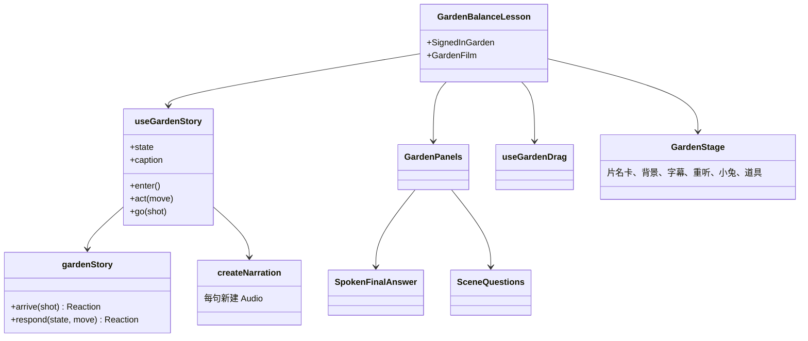
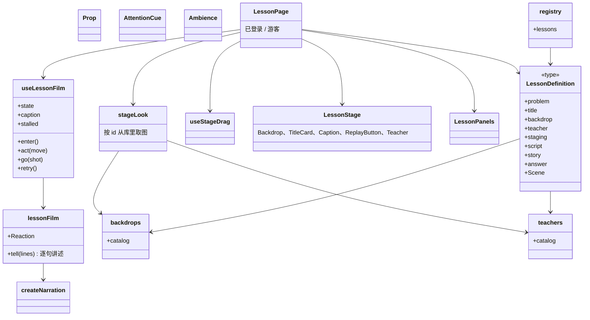

# 课堂公共部件与绘景库

- 日期：2026-11-08
- 状态：已确认
- 相关需求：REQ-001、REQ-004、REQ-010
- 相关决策：ADR-0013、[ADR-0015](../adr/0015-lesson-kit-and-media-library.md)

## 为什么要重新设计

#48 的三道原型（菜园天平、彩铅配对、数轴追及）和正式的菜园页各自写了一遍同样的东西：片名卡和开始按钮、背景层和暗角、字幕和重听、可拖可点的道具和发光圈、提示动画、逐句讲述和说完进下一幕。正式代码里，这些都写在菜园题自己的文件里：

- `lessons/garden-balance/useGardenStory.ts` 管逐句讲述、失败处理和进下一幕，`garden-story.ts` 的 `Reaction` 结构其实和题目无关。
- `components/garden-balance/GardenStage.tsx` 把片名卡、背景、字幕、重听、讲课角色和菜园道具写在一起，背景图和每幕的取景写死在它的 CSS 里。
- `lessons/garden-balance/useGardenDrag.ts` 是「拖过去或先点再点目标」的通用做法，只认菜园的道具。
- `pages/GardenBalanceLesson.tsx` 和 `GardenPanels.tsx` 把草稿、作答、提问、没登录提示接起来，下一道题要整段照抄。

照现在的结构接 #125、#126，每道题要复制三四百行页面代码，同一件事出现三种写法；一句旁白放不出来时直接跳过（#129）这种问题，也会在每道题各修一次。新题的背景每题单独生成，也浪费生成次数。

这次把这些做成所有题目共用的部件，题目只写自己的台词、分镜规则、道具画法和判定规则；背景和讲课角色从库里按标签挑。题目页撑满屏幕，用页面自己的返回按钮回到孩子来时的题库。

## 现在的设计



已经共用的部分：`bindObjectDrag`、`createNarration` / `useNarration`、`createChime`、`voiceMessage`、`spokenNumber`、`SpokenFinalAnswer`、`SceneQuestions`、`LessonSignInNotice`、`useLessonDraft`、`LessonRoute`。

问题：

- 新题要复制 `useGardenStory`、`useGardenDrag`、`GardenStage` 的外壳部分和两个页面文件，改名字再改细节。
- `lesson-pages.tsx` 和 `lessons.tsx` 每加一道题手写一段登记，没有检查保证台词都有录音、每幕都有进场台词、作答那一幕存在。
- 应用外壳的顶部导航和页脚始终显示，题目页只能在导航下面占一块。

## 目标设计

### 模块和职责



| 部件                                              | 位置（`apps/web/src/features/learning/` 下）                      | 职责                                                                                                                                                                                                                      |
| ------------------------------------------------- | ----------------------------------------------------------------- | ------------------------------------------------------------------------------------------------------------------------------------------------------------------------------------------------------------------------- |
| 逐句讲述 `lessonFilm`                             | `interaction/lesson-film.ts`                                      | 不依赖 React。`Reaction<State, Shot, Line>`（下一状态、要说的话、提示音、说完后进入的幕）；按顺序说几句，一句被新的操作打断时停下，一句放不出来时停在这一幕等孩子重听（#129）。                                           |
| 旁白播放 `createNarration`                        | `interaction/narration.ts`                                        | 一节课一个播放器元素，开始时那一下点按启用它；进题就预先下载本课所有录音；记录失败种类。                                                                                                                                  |
| 短片状态 `useLessonFilm`                          | `interaction/useLessonFilm.ts`                                    | 由 `useGardenStory` 推广而来：持有场景状态、字幕和播放状态，`enter`、`act`、`go`、`retry`；每到一幕通知页面（保存进度用）；离开时停掉所有声音。                                                                           |
| 拖动与点选 `useStageDrag`                         | `interaction/useStageDrag.ts`                                     | 由 `useGardenDrag` 推广而来：题目给出哪些道具能拿起、拿起时的影子长什么样、放到哪里算什么操作；拖过去和先点道具再点目标两种做法都支持。                                                                                   |
| 画面外壳 `LessonStage`                            | `components/lesson-stage/`                                        | 展示组件，撑满页面给它的格子。背景层（按幕取景）和道具世界按世界自己的比例一起放到最大，四周用模糊的同一张绘景补满；光晕和暗角、片名卡和开始按钮、顶部居中的片名条、重听按钮、字幕、讲课角色，中间放题目自己的 SVG 场景。 |
| 画面几何 `stage-look`                             | `components/lesson-stage/stage-look.ts`                           | 1200×675 的世界、矩形 `Box`、开场取景 `establishing`，以及背景被某一幕取景后，背景上的一块在世界里落在哪里（`framed`）；画面外壳和定义检查共用。                                                                          |
| 道具 `Prop`、影子 `DragGhost`                     | `components/lesson-stage/`                                        | 可点、可拖、键盘可达的道具，发光圈、选中、拿起、进场动画；道具的样子由题目以 SVG 传入。                                                                                                                                   |
| 提示 `AttentionCue`、氛围 `Ambience`、`BoardText` | `components/lesson-stage/`                                        | 「看这里」的飞行箭头、手指和脉冲三种样式；萤火虫、花瓣等点缀；黑板和标签文字。都遵守「减少动态效果」设置。                                                                                                                |
| 题目页 `LessonPage`、`LessonPanels`               | `pages/`                                                          | 由 `GardenBalanceLesson`、`GardenPanels` 推广而来：已登录时接草稿、按幕保存、最终作答、每幕提问和草稿提示；游客只看短片和登录提示。`lessonPage(定义)` 为一道题构造它的页面。                                              |
| 题目定义 `LessonDefinition`                       | `lessons/lesson-definition.ts`                                    | 一道题需要提供的全部内容，见下文。`stageLook(定义)` 按定义里的 id 从库里取背景和角色，交给 `LessonStage`。                                                                                                                |
| 题目登记 `lessons`                                | `lessons/registry.ts`                                             | 每道题一行：题目版本和按需加载的定义；应用外壳据此生成题目页，不再逐题手写。                                                                                                                                              |
| 绘景库 `backdrops`、角色库 `teachers`             | `media/backdrops/backdrops.ts`、`media/teachers/teachers.ts`      | 图片和带标签的清单，见「绘景库和角色库」。                                                                                                                                                                                |
| 库的检视 `BackdropSheet`、`TeacherSheet`          | `components/lesson-stage/LibrarySheet.tsx`、`ClearingOutline.tsx` | 只给人看图用：在 Storybook 里显示每张背景和它的空地框、每个角色和它的标签；题目的 story 也能叠加空地框和道具范围。孩子看不到。                                                                                            |

`libs/problems` 增加题目规则的辅助函数：整数答案的判定（整数判对错，其他判为无法判断）、每幕说明和词表的组装。题目插件照旧放在 `libs/problems/src/<题目>.ts`。

### 一道题要写什么

```ts
type LessonDefinition<
  State extends { shot: Shot | 'opening' },
  Shot extends string,
  Line extends string,
  Move,
  Piece extends string, // 能拿起的道具种类
  Look extends object, // 道具拿起时的样子
> = {
  problem: { id: string; version: number };
  title: string; // 片名卡和片名条上的题目
  theater: string; // 例如「菜园小剧场」
  labels: { film: string; world: string }; // 读屏时短片和道具区的名字
  backdrop: BackdropId; // 库里的背景
  teacher: { id: TeacherId; place: Box; ground: Ellipse }; // 库里的角色，和它在本题站的位置、脚下的影子
  staging: Box; // 各幕道具在 1200×675 世界里占的范围，每一幕都要在背景的空地里
  palette: StagePalette; // 从背景取的颜色
  defs?: ReactNode; // 题目的 SVG 颜料和符号
  ambience?: ReactNode; // 萤火虫、花瓣等点缀
  script: {
    lines: Record<Line, { text: string; clip: string }>;
    shots: readonly [Shot, ...Shot[]];
    entryLines: Record<Shot, readonly Line[]>;
    cameras?: Partial<Record<Shot, Camera>>; // 每幕背景的取景
  };
  story: {
    opening: State;
    arrive: (shot: Shot) => Reaction<State, Shot, Line>;
    respond: (state: State, move: Move) => Reaction<State, Shot, Line> | undefined;
    savesProgress: (shot: Shot) => boolean;
  };
  // 哪些道具能拿起、拿起时的影子、放下和点按对应的操作
  props: StageProps<Move, Record<Piece, Look>> & { carried: (look: Look) => ReactNode };
  answer: {
    shot: Shot; // 答对以后进入它的下一幕
    question: string;
    words: CountWords;
    choices: readonly number[];
    hints: readonly string[];
  };
  Scene: ComponentType<{ state: State; handling: Handling }>; // 题目自己的 SVG
};
```

`lessonPage(定义)` 为一道题构造它的页面，页面对这道题自己的状态、幕名、台词、操作和道具做泛型，所以每道题的类型从定义一直检查到页面。登记表只读定义里不含函数的部分（版本、台词、幕和取景、作答、背景、角色和道具范围），用来做定义检查。

题目的 `Scene` 不需要知道屏幕的形状：`LessonStage` 把背景和道具世界当成同一幅画，放到画框放得下的最大，道具总是落在背景画好的位置上。画框比宽还高时（例如竖着拿的手机），画面只看世界中间宽 910 的部分（x 从 145 到 1055），中间的道具因此更大，所以道具要摆在这一段里。每一幕的取景只缩放、移动背景，道具不动，所以背景上的空地在每一幕落在不同的地方；定义检查按每一幕的取景核对道具范围。

题目文件夹的结构不变：`lessons/<题目>/` 放台词、分镜规则和定义，`components/<题目>/` 放道具画法和 `Scene`。页面、旁白、拖动、作答、提问、草稿都不再写在题目里。

以后再加一道题，要改的只有：新的题目插件、新的 `lessons/<题目>/` 和 `components/<题目>/`，以及 `registry.ts` 里加一行。公共部件放不下这道题的需要时，先在公共部件里补上（先重构、后加功能），再做这道题。

### 全屏和返回

- 应用外壳分两种布局：普通页面带顶部导航（`app/SiteLayout`）；题目页 `/problems/:id/:version` 不带，画面撑满屏幕（`100dvh`，用 `viewport-fit=cover` 和 `env(safe-area-inset-*)` 留出刘海和圆角的安全区）。
- 题目页里，短片占满上方，作答、提问、草稿提示或登录提示放在下方一条，最多占约 40% 屏高，放不下时这一条自己滚动；横着拿的手机（高度不超过 500px）上，这一条移到右边一栏。
- 孩子点「开始短片」或「接着上次的地方」时请求整页全屏（`document.documentElement`），这样应用外壳叠在页面上的更新提示在全屏时也看得见。浏览器不支持或拒绝时（例如 iPhone Safari），保持撑满屏幕，不提示错误。
- 画面左上角固定一个返回按钮，读屏名称为「返回」：在站内从别的页面点进来的，回到上一页，题库的年级、科目、分类和滚动位置都不变（滚动位置由 `app/useScrollMemory` 按历史记录保存在这个标签页的会话里，刷新后也在，后退时恢复）；直接打开链接进来的，用替换历史记录的方式去这道题所在的题库分类。离开时退出全屏；用浏览器后退等其他方式离开时也退出全屏。
- 进度每到一幕就保存，所以返回时不再询问是否保存；还有写请求在路上时（例如正在判定的最终答案），按钮旁边显示「正在保存，好了就返回」，等请求结束再离开，不论成功还是失败。失败的答案服务器没有记录，下次进来可以重新回答，不会重复计分。断网时暂停发送的请求不让孩子等。
- 题库仍由 `features/library` 负责：`ProblemPage` 提供全屏画框和返回目标，题目页面填进画框；两个功能互不引用。画框 `FullscreenFrame` 放在 `shared/ui/`；全屏请求 `fullscreen`、`useFullscreen` 和离开方式 `useLeave` 放在 `shared/lib/`。题目的短片用 `useFullscreen`，从开始短片起占着全屏，离开页面时退出。

### 绘景库和角色库

每张背景都是 16:9 的电影级绘景，中间留一块干净、偏暗的空地放道具，不画角色、文字和操作对象。图片放在 `media/backdrops/`，文件名就是它的 id；清单 `backdrops.ts` 里每张图有：

| 字段         | 内容                                                                              |
| ------------ | --------------------------------------------------------------------------------- |
| `id`、`file` | 例如 `garden-morning`，`garden-morning.webp`                                      |
| `setting`    | 场景：菜园、画室、火车工作间、厨房、教室、星空……                                  |
| `light`      | 时间和色调：清晨暖光、黄昏蓝调、室内灯光……                                        |
| `ages`       | 适合的年龄段：低年级（1–2）、中年级（3–4）、高年级（5–6），可多选                 |
| `clearing`   | 空地形状：下方中间一张桌面（`table`）、中间一条横带（`band`）、整片开阔（`open`） |
| `clearZone`  | 空地在 1200×675 世界坐标里的矩形，按图片铺满整个世界、不缩放时量得                |
| `focus`      | 画框比例和图片不同时保留在画面里的位置，例如 `center 56%`                         |
| `fits`       | 适合的科目或题型：称重和等量、配对和计数、数轴和行程、几何、语文故事……            |
| `prompt`     | 生成时用的提示词                                                                  |

角色图放在 `media/teachers/`，清单 `teachers.ts` 里有：`id`、`file`、名字（例如小兔）、适合的年龄段、性格说明和生成提示词。角色站在哪里、脚下的影子在哪里随场景不同，由每道题的定义给出；配色从背景取，也留在题目定义里，等两道题共用同一张背景时再提到库里。

库里有 #48 的三张背景和小兔，图片与 #48 归档的文件逐字节相同，提示词照 #48 的 `SPIKE.md` 记录；还有 #135 按 [绘景和讲课角色的风格说明与提示词](lesson-media.md) 生成的第一批 12 张背景（低、中、高年级各 4 张）和 3 个角色（每个年龄段一个）：

| id                          | 场景           | 时间和色调     | 年龄段         | 空地     | 适合                         |
| --------------------------- | -------------- | -------------- | -------------- | -------- | ---------------------------- |
| `garden-morning`            | 菜园           | 清晨暖光       | 低年级         | 下方桌面 | 称重和等量、替换和比较       |
| `art-studio-evening`        | 画室           | 傍晚紫橙灯光   | 低年级、中年级 | 整片开阔 | 配对和计数、排列和分类       |
| `railway-workshop-dusk`     | 火车工作间     | 蓝调时分灯光   | 高年级         | 整片开阔 | 数轴和行程、方程             |
| `forest-picnic-morning`     | 林间草地       | 清晨薄雾阳光   | 低年级         | 下方桌面 | 分东西和平均分、配对和计数   |
| `pastry-shop-afternoon`     | 街角点心铺     | 午后奶油色暖光 | 低年级         | 下方桌面 | 买卖和凑钱、加法和减法       |
| `toy-classroom-day`         | 积木玩具教室   | 白天窗边光     | 低年级         | 整片开阔 | 图形和拼搭、排列和分类       |
| `seaside-beach-noon`        | 海边沙滩       | 晴天正午       | 低年级         | 中间横带 | 找规律、数一数和比多少       |
| `town-market-afternoon`     | 小镇集市       | 午后阳光       | 中年级         | 中间横带 | 买卖和价格、乘法和除法       |
| `woodshop-morning`          | 木工坊         | 晨光斜照       | 中年级         | 下方桌面 | 测量和长度、面积和周长       |
| `library-corner-rainy`      | 图书馆一角     | 雨天室内灯光   | 中年级         | 整片开阔 | 语文故事和阅读、时间和日历   |
| `greenhouse-noon`           | 植物温室       | 正午柔光       | 中年级         | 下方桌面 | 统计和图表、观察和记录       |
| `observatory-night`         | 山顶天文台     | 深夜星光       | 高年级         | 整片开阔 | 角度和方向、比和比例尺       |
| `science-lab-evening`       | 科学实验室     | 傍晚冷白灯光   | 高年级         | 下方桌面 | 分数和百分比、浓度和配比     |
| `city-model-studio-morning` | 城市模型工作室 | 清晨蓝白光     | 高年级         | 下方桌面 | 几何和立体图形、比例尺和地图 |
| `river-bridge-dusk`         | 河边大桥       | 黄昏金光       | 高年级         | 中间横带 | 行程和相遇、工程问题         |
| `rabbit`（角色，小兔）      | —              | —              | 低年级         | —        | —                            |
| `squirrel`（角色，小松鼠）  | —              | —              | 低年级         | —        | —                            |
| `raccoon`（角色，小浣熊）   | —              | —              | 中年级         | —        | —                            |
| `owl`（角色，猫头鹰博士）   | —              | —              | 高年级         | —        | —                            |

图都由 OpenAI 的图像模型按同一份风格说明生成：在 Codex 里用 ImageGen，或者经维护者批准用维护者的密钥调用 Images API；Claude Code 不自己画。出图的做法、参数和看图的检查项见 `lesson-media.md`。加一张图：把 WebP 放进对应文件夹，在清单里加一条，在 `backdrops.stories.tsx` 或 `teachers.stories.tsx` 里加一个 story；单元测试检查文件和清单一一对应、标签齐全、空地在世界里、每张图都有 story，视觉测试随 story 生成基准。

新题按这个顺序挑：先按年龄段，再按空地形状是否放得下这道题的道具，最后按场景和题型。都不合适时，按同一份风格说明生成一张通用的新背景加进库里，而不是只给这道题画一张。

清单只含图片的地址，引用它不会下载图片；图片在页面真正显示它时才下载，所以打开一道题只下载这道题的背景和角色。别的页面要用库里的图（例如题库卡片的缩略图、账号页的插画）时，由应用外壳 `app/` 从清单取地址，再交给那个功能的页面。

## 接口对比

| 接口       | 现在                                         | 改成                                                  | 兼容方式                     |
| ---------- | -------------------------------------------- | ----------------------------------------------------- | ---------------------------- |
| 逐句讲述   | `useGardenStory` 里的 `sayLine`、`tell`      | `interaction/lesson-film.ts` 的 `tell`                | 直接替换，只有菜园一个调用方 |
| 短片状态   | `useGardenStory(onArrive)`                   | `useLessonFilm(definition, onArrive)`                 | 直接替换                     |
| 拖动与点选 | `useGardenDrag(story)`                       | `useStageDrag(story, definition.props)`               | 直接替换                     |
| 画面外壳   | `GardenStage`                                | `LessonStage` + 题目的 `Scene`                        | 直接替换，视觉基准保持不变   |
| 题目页     | `GardenBalanceLesson`、`GardenPanels`        | `LessonPage` + `LessonDefinition`                     | 直接替换                     |
| 题目登记   | `lesson-pages.tsx`、`lessons.tsx` 逐题手写   | `lessons/registry.ts` 一行一题                        | 直接替换                     |
| 旁白播放   | `createNarration` 每句新建 `Audio`           | 同名，一个播放器、预先下载                            | 签名不变，行为由 #129 修改   |
| 题库页面   | `ProblemPage` 带「返回题库」链接，在导航下面 | 全屏画框带返回按钮                                    | 外观改变，新的视觉基准       |
| 背景和角色 | 题目自己的 `assets/` 里的图和写死的对象      | 定义里写库的 id，`stageLook` 从 `media/` 的清单里取图 | 直接替换，视觉基准保持不变   |

## 数据结构变更

无。草稿仍按幕名保存，题目版本不变，已保存的进度照常恢复。

## 迁移步骤

| 步骤 | 内容                                                                                    | 行为是否改变 | issue                                                       |
| ---- | --------------------------------------------------------------------------------------- | ------------ | ----------------------------------------------------------- |
| 1    | 重构：抽出逐句讲述、`useLessonFilm` 和 `useStageDrag`，菜园题改用                       | 否           | [#130](https://github.com/juanchaopan/education/issues/130) |
| 2    | 修复：旁白一个播放器、预先下载、放不出来时停下等重听，并加公共放音检查                  | 是           | [#129](https://github.com/juanchaopan/education/issues/129) |
| 3    | 重构：抽出 `LessonStage`、`Prop`、`AttentionCue`、`Ambience`、`BoardText`，菜园画面改用 | 否           | [#131](https://github.com/juanchaopan/education/issues/131) |
| 4    | 重构：`LessonDefinition`、`LessonPage`、登记表和定义检查，题目规则辅助函数，菜园题改用  | 否           | [#132](https://github.com/juanchaopan/education/issues/132) |
| 5    | 功能：题目页全屏和返回按钮                                                              | 是           | [#133](https://github.com/juanchaopan/education/issues/133) |
| 6    | 功能：绘景库和角色库，#48 的三张背景和小兔入库，菜园题从库里取                          | 否           | [#134](https://github.com/juanchaopan/education/issues/134) |
| 7    | 素材：生成第一批 12 张背景和 3 个角色，入库                                             | 否           | [#135](https://github.com/juanchaopan/education/issues/135) |
| 8    | 文档和工具：手册的公共部件清单、新题模板、旁白录音脚本、自查卡加项                      | 否           | [#136](https://github.com/juanchaopan/education/issues/136) |

步骤 1、3、4 每一步合并后菜园题的单元测试、e2e 和视觉基准都不变。步骤 7 只依赖步骤 6，可以和步骤 8 同时进行。#125、#126 排在这些步骤之后，直接用公共部件，也用来检验部件够不够用；不够的地方先补公共部件。

## 测试策略

- 重构步骤：菜园题现有的单元测试、e2e（`e2e/garden-balance.spec.ts`）和视觉基准是行为基准，必须原样通过；公共部件各自补单元测试和 Storybook story。
- 定义检查：一个单元测试遍历登记表，检查每道题的每句台词都有录音、每幕都有进场台词、作答那一幕在幕序里且后面还有一幕、题目版本在登记表、定义和题目插件里一致、幕名和题目插件的步骤一致、作答用到的提示都在插件里、按每一幕的取景道具范围都在所选背景的空地里，并且题库里的每个题目版本都有登记的题目。背景和讲课角色的 id 只能是库里有的，写错时类型检查不通过。
- 放音检查（#129）：e2e 的共用工具按台词逐幕检查每句都播放到结束，在桌面 Chromium、手机模拟和 WebKit 上跑；登记表里的每道题都要接入。
- 分层检查：`npm run arch` 增加规则，一道题的文件不能引用另一道题的文件，题目的代码只在打开时加载，网站的代码不引用题目插件。
- 全屏和返回：e2e（`e2e/lesson-frame.spec.ts`）覆盖从题库进入后返回原分类和滚动位置、直接打开链接后返回、浏览器后退键、开始短片时请求全屏（浏览器拒绝或不支持时页面照常）、手机竖屏和横屏、平板和电脑上画面撑满且返回按钮可用键盘到达，以及正在判定答案时返回要等判定结束、只发一次（孩子的登录和服务器的回答由测试代答，不需要数据库）。
- 绘景库：单元测试检查清单和文件夹里的图片一一对应、标签齐全、空地在世界里、每张图都有 story；Storybook 里每张背景显示空地范围，供人工看图，视觉基准覆盖每张背景和角色；菜园题另有一个 story 叠加空地框和道具范围。e2e（`e2e/lesson-media.spec.ts`）检查题库页不下载库里的图，打开菜园题只下载菜园背景和小兔。

## 考虑过但没采用的方案

- 单独建一个 `libs/lesson-kit` 包：只有网站一个使用方，单独成包要多一层构建和版本，现有的分层检查已经能管住边界。
- 每道题继续单独生成背景：每题都要生成，风格也不统一。
- 只隐藏导航、不请求浏览器全屏：地址栏和浏览器按钮仍然占屏幕，孩子容易误点浏览器的后退。
- 一次把彩铅和数轴的需求也做进公共部件：先只抽菜园已有、三个原型都用到的部分；两道题接入时缺什么再补，避免为猜测的需要做抽象。
- 把所有题目的定义擦成同一个类型交给一个公共页面：要靠方法签名的双变性才能放进同一张表，页面里也查不到每道题自己的类型；按题构造页面没有这些问题。
- 给 `Scene` 加画面布局参数，让题目按屏幕形状重新摆道具：背景和道具世界作为同一幅画一起缩放后，道具总在背景画好的位置，每道题不必为不同屏幕各写一套摆法。
- 只让画框全屏、不让整页全屏：应用外壳的更新提示不在画框里，全屏时会被挡住。
- 题目页叠在题库上面、题库保持挂载，免去恢复滚动位置：直接打开题目链接时没有题库可叠，题库还会在题目背后一直占着内存和请求；按历史记录恢复滚动位置对两种进入方式都一样。
- 返回按钮按页面的刷新就绪状态（`saving`）等待：那里也算上了小兔正在回答的问题和语音转写，孩子按返回会被慢请求拖住；返回只等真正写到服务器上的请求。
- 让 `LessonStage` 自己按 id 查库：它是展示组件，收到解析好的图片地址更容易单独渲染和测试；`stageLook` 在题目定义一侧做这一步。
- 逐幕在浏览器里量每个道具的位置来检查它们在空地里：每道题都要写一遍逐幕走查；定义里声明道具范围，单元测试按每一幕的取景比对空地，再在 Storybook 里叠加两个框人工看，成本低得多。
