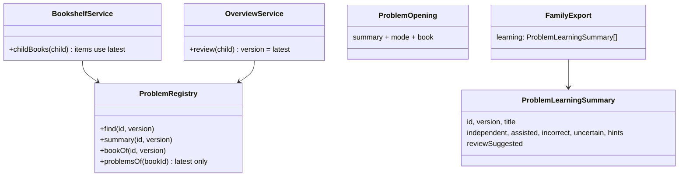
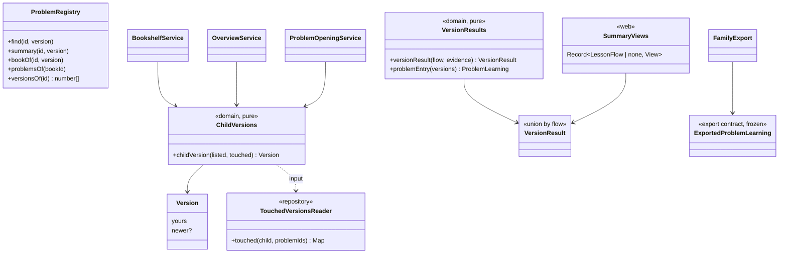

# 题目版本的代码结构：孩子的版本和按题的学习摘要

- 日期：2026-11-15
- 状态：维护者 2026-11-15 确认拆分（重构 → 孩子选版本 → 按题的学习摘要 → 按版本的详情）；按 issue 实施。
- 需求：REQ-005、REQ-009（2026-11-15 修改）；页面和规则见 [题目的版本](../problem-versions.md)。
- 决策：[ADR-0005](../../adr/0005-data-consistency.md)（草稿按版本存）、[ADR-0009](../../adr/0009-account-security-spike.md)（GET、HEAD 不写业务数据）不变，不加新的 ADR。

## 为什么要调整结构

新需求里有三个代码里没有的概念：

1. **孩子的版本。** 一道题对一个孩子打开哪个版本，由孩子做过的版本和清单里的版本一起决定。代码里取版本的地方有三处，各自直接取最新版本：孩子的书的题目列表（`apps/api/src/learning/services/bookshelf.ts` 给 `items` 的地方）、总览的「值得再练」、以及网页的书卡和题目页按 `items` 的版本拼地址（`ChildBookCard.tsx`、`ProblemPage.tsx`）。直接在三处各加「查孩子做过的版本」会写出三份一样的规则，以后改一处漏一处。
2. **一道题的全部版本。** 注册表（`libs/problems/src/plugin.ts`）只按 `id/version` 查一个版本、按书列最新版本，列不出一道题的全部版本，详情页要的「没做过的版本」没有来源。
3. **按题、按流程的结果。** 学习摘要的契约 `ProblemLearningSummary`（`libs/contracts/src/learning-summary.ts`）是一个版本一行、五个次数；家庭导出（`family-export.ts`）也用它。直接把它改成按题的形状会改掉导出的文件；在它上面加字段，会出现同一个契约既按版本又按题的两种用法。结果按流程不同（逐幕探究有变化题），用一组可选字段表达，加一种流程时没有地方提醒要设计它的显示。

## 现在的结构

问题：取哪个版本分散在三处；注册表只认最新版本；学习摘要和导出共用一个按版本计数的契约。

## 目标结构

- **`versionsOf(id)`**：注册表按编号从小到大列出一道题清单里的全部版本，不存在的题给空列表。
- **孩子的版本（`learning/domain`）**：纯函数，输入清单里的版本和孩子做过的版本，给出孩子的版本 `yours` 和新版本 `newer`，规则就是 [用到的词](../problem-versions.md#用到的词) 和 [打开哪个版本](../problem-versions.md#打开哪个版本) 的表。孩子的书、总览、打开一道题和选版本都只调它。
- **做过的版本（仓储）**：一次查出一个孩子一批题做过的版本，从 `progress`、`help_events`、`variation_answers`、`variation_help` 和 `child_problem_versions` 合起来读；孩子的书和总览一次查一批，不按题逐道查。
- **一个版本的结果（`learning/domain`）**：纯函数，按这个版本的课堂流程从它的证据得出 `VersionResult`；按题的一项取做过的最大版本。规则是 [结果只有三种](../problem-versions.md#结果只有三种) 的表。
- **`VersionResult`（`libs/contracts`）**：按 `flow` 区分的联合类型，每种流程一种；网页的显示表 `Record<LessonFlow | 'none', …>` 按 `flow` 取画法。加一种课堂流程（`lessonFlows` 多一个名字）时，契约和显示表都要加一项，类型检查才通过：新流程没设计摘要的显示就合并不了。
- **导出的契约**：家庭导出用自己的 `ExportedProblemLearning`（和导出文件里的形状一样），学习摘要的契约改动不影响它。

同类的需求再来时：加一种课堂流程，只加 `VersionResult` 的一种、一个版本的结果里的一个分支、显示表的一行；孩子的版本、仓储和页面结构不变。题目再出新版本，什么代码都不用改。

## 接口前后

| 接口                                                          | 改动前                                                    | 改动后                                                                       | 兼容                                                 |
| ------------------------------------------------------------- | --------------------------------------------------------- | ---------------------------------------------------------------------------- | ---------------------------------------------------- |
| 注册表 `versionsOf`                                           | 没有                                                      | `versionsOf(id): number[]`                                                   | 只加（第 1 步）                                      |
| 孩子的版本                                                    | 三处各取最新版本                                          | `childVersion(listed, touched): { yours, newer? }`                           | 第 1 步收拢成一个入口，总给最新版本；第 2 步接上记录 |
| `ProblemOpening`                                              | 题目摘要 + `mode` + `book`                                | 做题模式多 `yours`、可选的 `newer`                                           | 只加字段（第 2 步）                                  |
| `POST /api/v1/problems/:id/:version/choice`                   | 没有                                                      | `{}` → 204                                                                   | 只加（第 2 步）                                      |
| `GET /api/v1/children/assignments` 的 `items[].version`       | 最新版本                                                  | 孩子的版本                                                                   | 字段不变，值跟着孩子（第 2 步）                      |
| 总览 `review`                                                 | `{ id, version, title, incorrect }`，`version` 是最新版本 | `{ id, version, title }`，`version` 是孩子的版本                             | 第 2 步改值，第 3 步去掉 `incorrect`；网页同一 PR 改 |
| `GET /parents/children/:childId/learning-summary`             | `ProblemLearningSummary[]`，一个版本一行                  | `ProblemLearning[]`：`{ id, title, result: VersionResult, reviewSuggested }` | 直接换（第 3 步）：唯一的调用方是同一次部署的网页    |
| `GET /parents/children/:childId/problems/:problemId/versions` | 没有                                                      | 详情，见 [接口](../problem-versions.md#家长按版本的详情)                     | 只加（第 4 步）                                      |
| 家庭导出的学习摘要                                            | `ProblemLearningSummary`                                  | `ExportedProblemLearning`，形状一样                                          | 第 1 步换类型，文件逐字不变                          |

## 数据结构

只加不删：第 2 步加 `child_problem_versions(child_id, problem_id, version, decided_at)`，主键是孩子加题目，随孩子删除，开启行级安全；列见 [数据](../problem-versions.md#数据)。旧数据不用迁移：没有这张表的记录时，孩子的版本从作答和帮助记录得出。部署后回滚到上一个提交时，多出的表没有人读，不影响旧代码。

## 迁移步骤

| 步骤 | 内容                                                                                                                                                                                        | 行为变化 | issue                                                       |
| ---- | ------------------------------------------------------------------------------------------------------------------------------------------------------------------------------------------- | -------- | ----------------------------------------------------------- |
| 1    | 特征测试加重构：带两个版本的测试注册表；先补测试固定孩子的书、总览、打开一道题、学习摘要和导出的行为；加 `versionsOf`；三处取版本收拢到孩子的版本的入口（总给最新版本）；导出换成自己的契约 | 否       | [#253](https://github.com/juanchaopan/education/issues/253) |
| 2    | 扩展并接上：`child_problem_versions`、做过的版本的仓储、孩子的版本接上记录；`ProblemOpening` 加字段、选版本的接口；题目页问新版本；孩子的书和总览跟着孩子的版本                             | 是       | [#254](https://github.com/juanchaopan/education/issues/254) |
| 3    | 一个版本的结果、`VersionResult` 和显示表；学习摘要换成按题；建议复习和「值得再练」不写次数                                                                                                  | 是       | [#255](https://github.com/juanchaopan/education/issues/255) |
| 4    | 按版本的详情接口和页面                                                                                                                                                                      | 是       | [#256](https://github.com/juanchaopan/education/issues/256) |

没有单独的收缩步骤：改动前的接口除学习摘要和总览 `review` 以外都只加不改，这两个的调用方只有同一次部署的网页，在各自的 PR 里一起换掉。每多拆一个 PR 就多一轮 CI、审查和变基，所以扩展和改调用方放在同一个功能 PR 里；重构单独一个 PR，不和功能混在一起。

## 测试

- **第 1 步保持行为。** 先写特征测试并在重构前通过：孩子的书的 `items` 和总览的 `review` 是最新版本；打开一道题的回答；学习摘要按版本的行；家庭导出的文件和改动前逐字一样（快照对比）。重构后同一套测试不改就通过。
- **功能。** 孩子的版本和一个版本的结果是纯函数，表里每一种情况一条单元测试；仓储和接口用真实数据库测（`test:db:local`）；页面用 Storybook story、组件测试和视觉基准；端到端用测试注册表的两个版本走孩子被问、留下、选新版本和家长看摘要、看详情。
- 测试注册表只在测试里，不进题目清单。

## 考虑过但没采用

- **在学习摘要的契约上加按题的字段，导出照用**：同一个契约同时是按版本和按题的两种东西，导出会带上用不到的字段，版本号也得跟着变。
- **结果用一组可选字段（`guess?`、`reason?`）**：加一种流程时没有地方逼人设计它的显示，空字段的意思也说不清是「没有这一项」还是「还没做」。
- **把孩子的版本存成每个孩子每道题一行，作答时更新**：要在作答、提示、变化题几处写入时都记得更新它，和作答记录对不上时不知道信谁；只存孩子的选择，其余从作答记录读出。
- **页面自己算孩子的版本**：页面拿不到孩子在别的版本上的作答记录，规则也会在网页和服务器上各写一份。
