# #138 全站视觉风格样稿

[#138](https://github.com/juanchaopan/education/issues/138) 探针的记录。结论见 [ADR-0016](../../adr/0016-visual-language.md) 和 [网站视觉语言](../../design/visual-language.md)。

## 做了什么

用一次性的 HTML、CSS 和 SVG 画了三个风格方向，每个方向同一组页面：孩子题库首页、孩子登录、家长空间总览、题目页周边、部件样张，各有桌面（1280 宽）和手机（390 宽）两种尺寸。

- A 手作工作台：暖色纸张和纸纹、森林绿、黏土般有厚度的按钮、楷体标题。
- B 暮光剧场：深墨绿夜景、暖金按钮和光晕、半透明玻璃卡片。
- C 晨光绘本：明亮的矢量插画横幅，不用绘景。

图片只用了 #48 的三张绘景和小兔（OpenAI 生成）；图标、风景插画和界面都是代码画的。样稿代码、全部截图和截图脚本归档在标签 [archive/spike-138-visual-language](https://github.com/juanchaopan/education/tree/archive/spike-138-visual-language/spikes/138-visual-language)，不进入 main。

## 维护者的选择

2026-11-08：“A、B 都有背景图片，不错。能不能 A 和 B 按照客户端当前时间来切换？自动切换。”于是白天用 A、晚上用 B；C 不采用。文字清单写在设计文档的「现有文字的处理」里。

## 截图

| 页面               | A 手作工作台（白天）      | B 暮光剧场（晚上）        |
| ------------------ | ------------------------- | ------------------------- |
| 题库首页           | 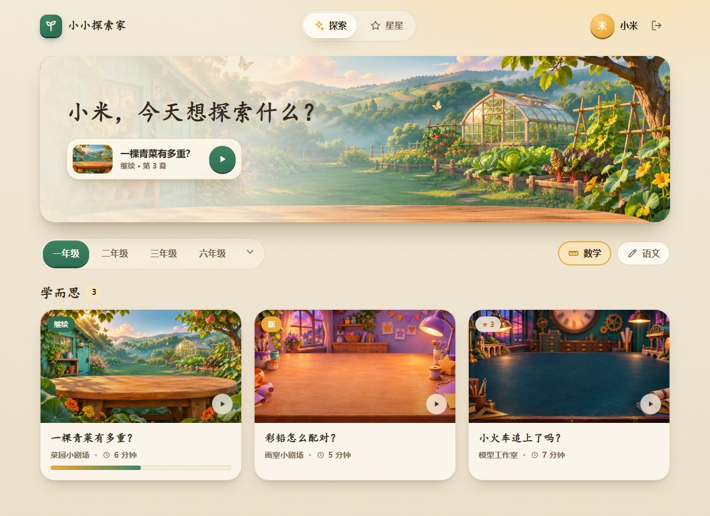   | 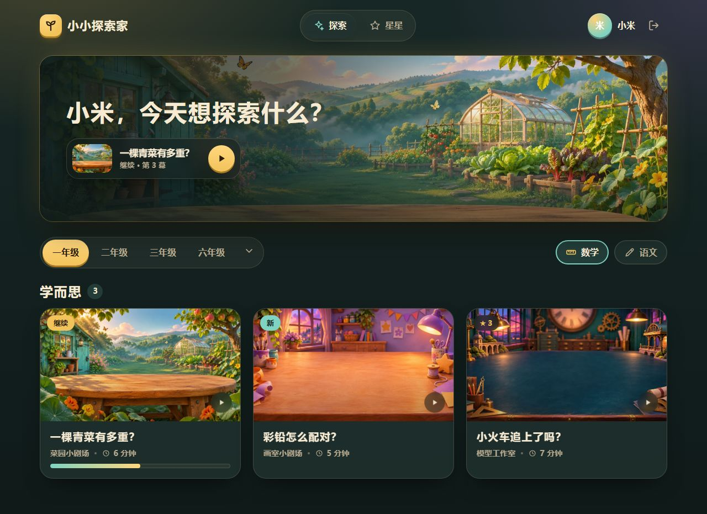   |
| 题库首页（手机）   | 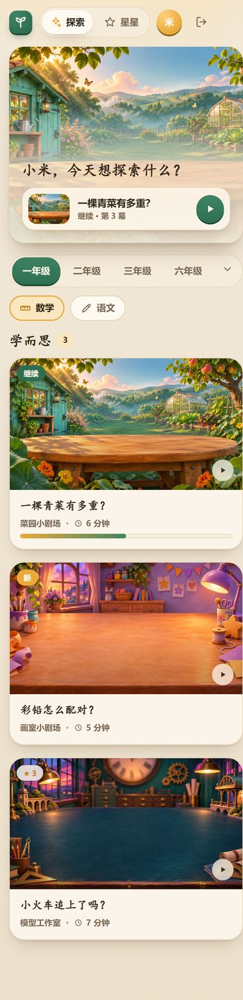     | 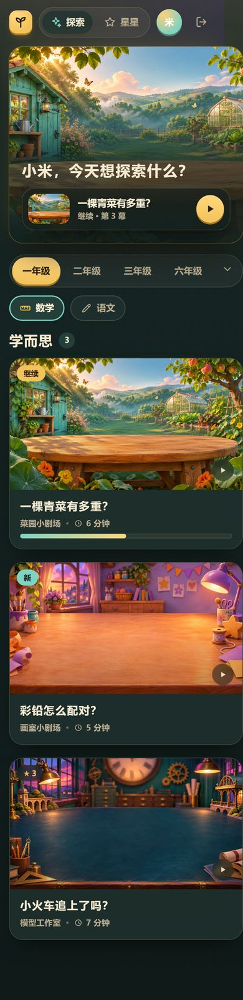     |
| 孩子登录           | 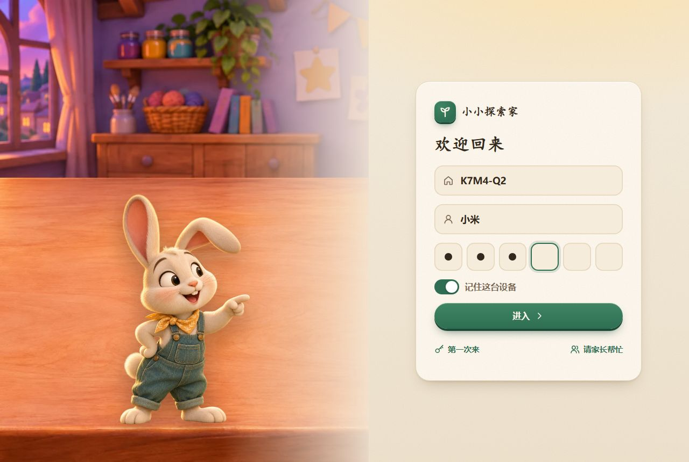  | 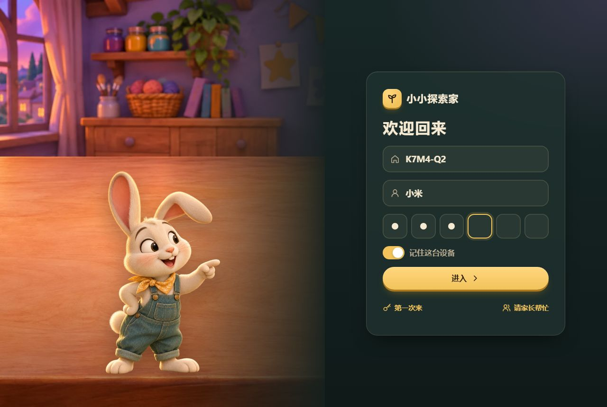  |
| 家长空间           | 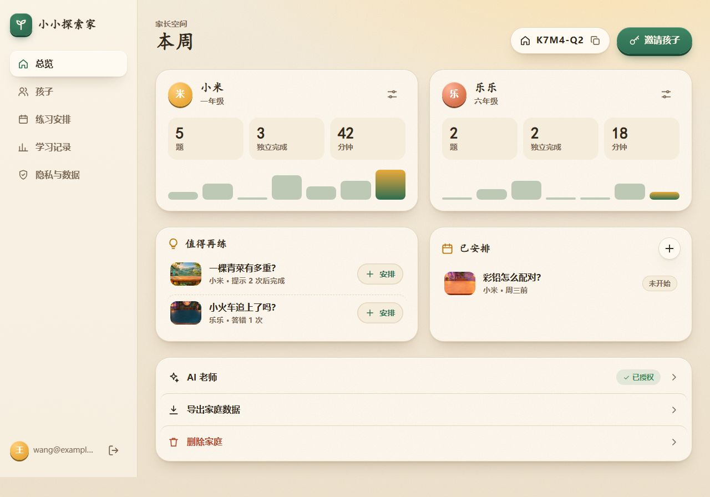 | 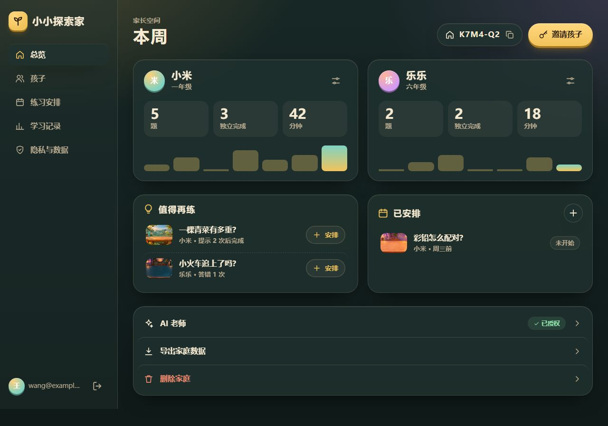 |
| 家长空间（手机）   | —                         | 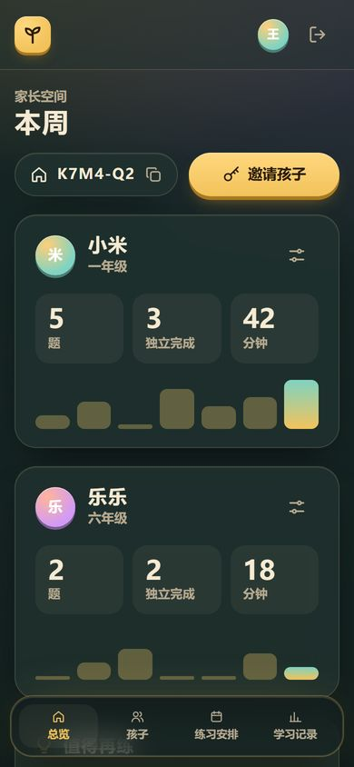   |
| 题目页周边         | 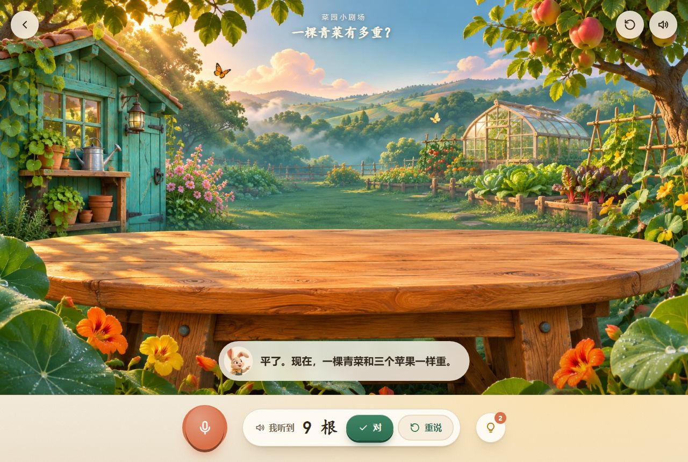 | 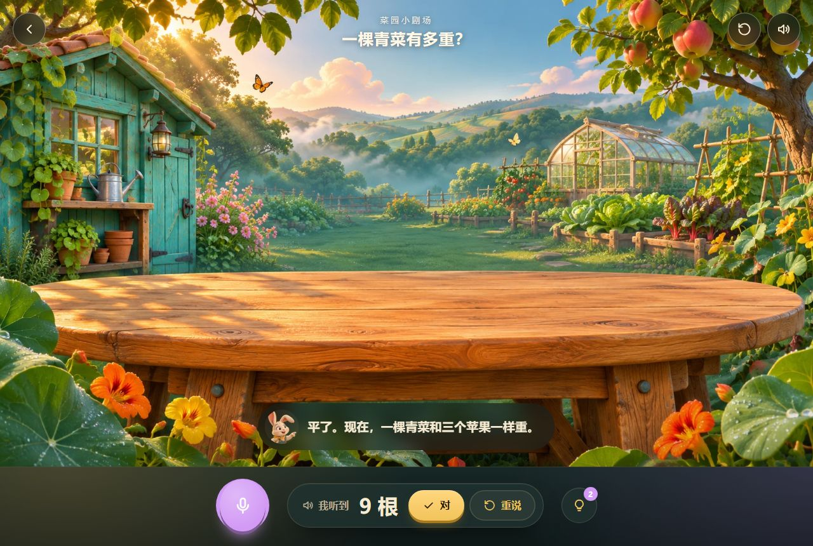 |
| 题目页周边（手机） | —                         | 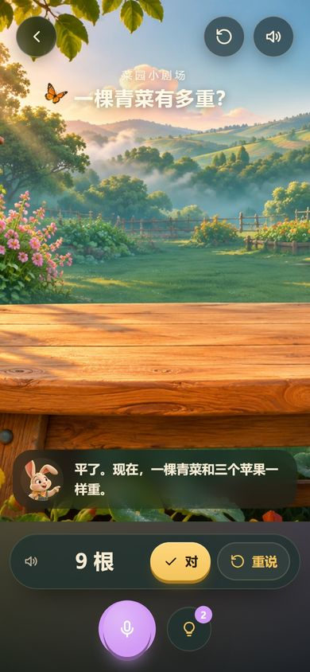   |
| 部件样张           | 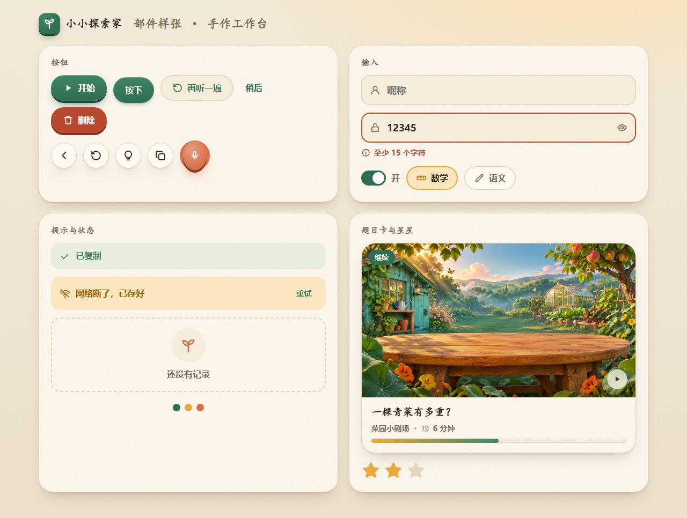    | 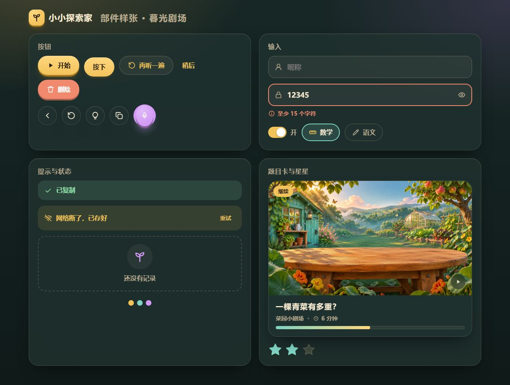    |

未采用的 C 晨光绘本：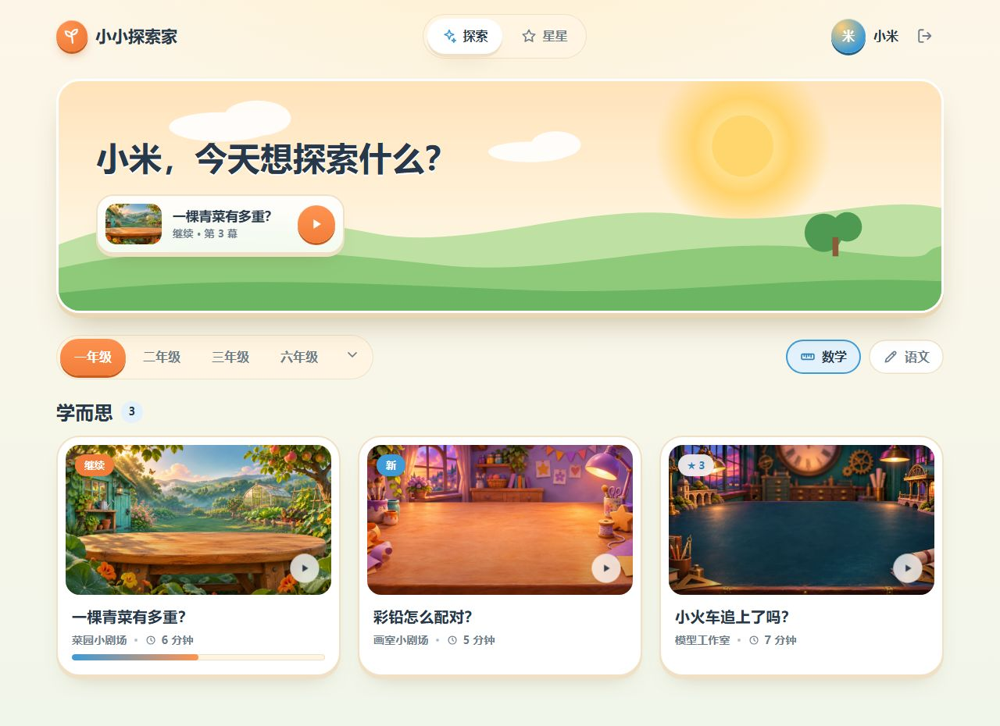

## 未验证的范围

- 样稿是静态页面，没有接真实数据，也没有跑可访问性检查；两套主题的对比度在 #140 用工具核对。
- 楷体标题在样稿里用的是 Windows 系统楷体，正式实现换成自托管的霞鹜文楷子集，字形会略有不同。
- 动效只在浏览器里打开样稿时可见，截图里是静止状态。
