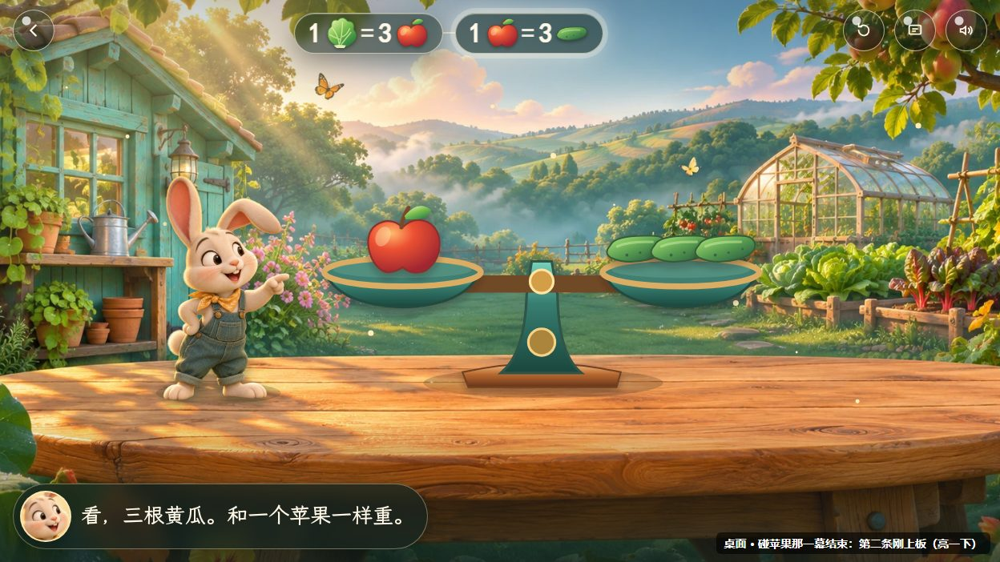
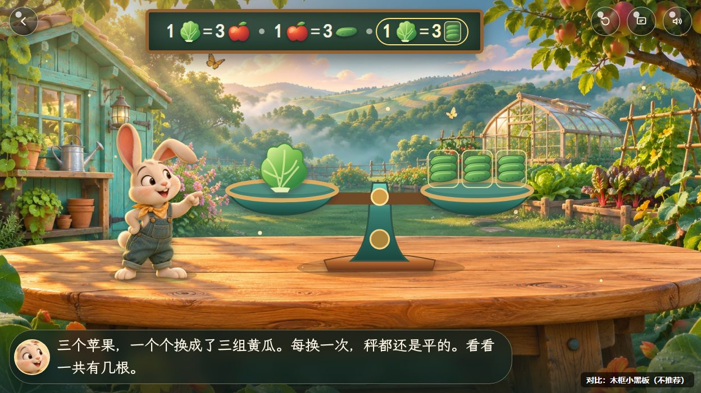
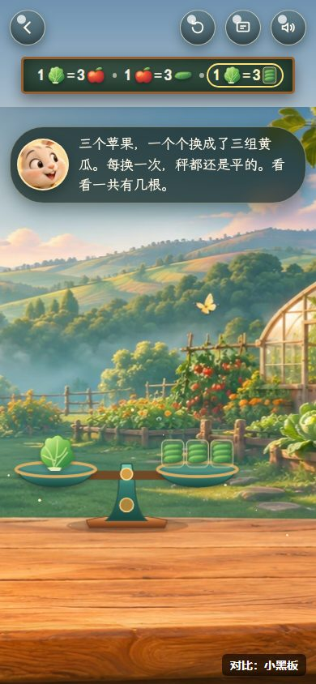
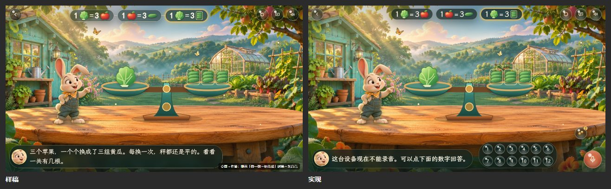
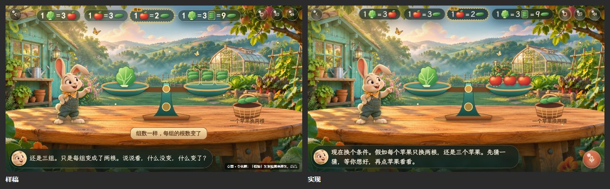
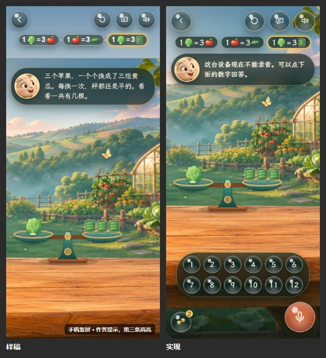
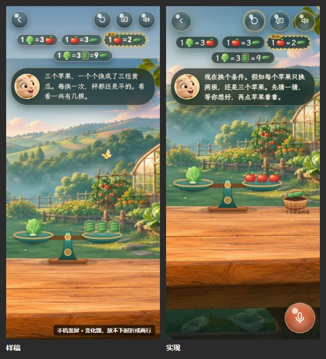
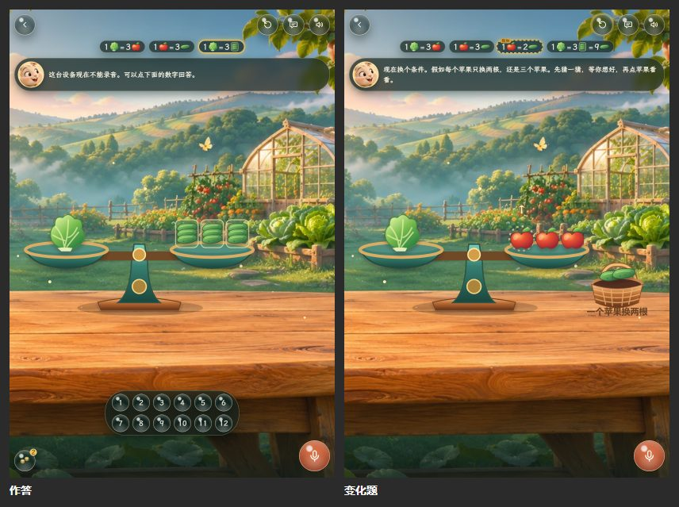

# #181 结论板：样稿、维护者的选择和实现

[#181](https://github.com/juanchaopan/education/issues/181) 的样稿和维护者的选择。结论板是课堂公共部件清单里的一项，讲法选用它的题才用；菜园天平是第一道。

## 样稿

样稿是一次性的 HTML，底图是菜园题 story 的视觉基准截图，返回和工具露珠是近似画的，字体用系统楷体代替霞鹜文楷；手机的样稿把画面整体下移约 130px，近似结论板在工具下面多占的一行。

推荐的烟色玻璃胶囊：

- 碰苹果那一幕结束，第二条刚上板、亮一下：
- 其余状态和实现并排，见下面的「样稿和实现对照」。

对比用、没有选的木框小黑板：

| 桌面                          | 手机竖屏                       |
| ----------------------------- | ------------------------------ |
|  |  |

## 维护者的选择

2026-11-11：

- 样子：和 #143 的 B「露珠」一样的烟色玻璃胶囊，用 `--dew-*` 令牌，不用小黑板或木牌。
- 每条结论写成「数字 + 道具小图 = 数字 + 道具小图」；「3 组黄瓜」画成「3」加一个和秤盘上一样的黄瓜组小图；孩子答对以后在第三条后面接上「= 9 根黄瓜」；不放「= ?」的问号胶囊。
- 高亮：用到它的幕里一直亮着，作答时收到的提示用到它时也亮；金色描边加柔光，减弱动画时只剩静止的描边。
- 新的一条在自己的位置淡入、亮一下，不从秤上飞过来。
- 手机竖屏：在工具下面一行，放不下时折成两行，道具按剩下的高度缩放。
- 变化题的「假如」条紧挨原来那条，蜜黄虚线框，角上一个「假如」角标。

## 样稿和实现对照

左边是样稿，右边是实现的菜园题页，用测试代答孩子的登录、草稿和作答，减弱动画下截图（桌面 1280×720，平板 820×1180，手机 390×844）。

| 状态                                     | 对照                       |
| ---------------------------------------- | -------------------------- |
| 桌面，作答那一幕，第三条高亮             |     |
| 桌面，变化题，「假如」条紧挨原来那条     |  |
| 手机竖屏，作答那一幕                     |       |
| 手机竖屏，变化题，折成两行               |    |
| 平板竖放，作答和变化题（样稿没有画平板） |             |

和样稿的不同：

- 胶囊之间没有连接短线：板折成两行时第二行开头会多出一截悬空的短线，改成留白分隔；「假如」条和它改的那条放在同一项里，靠得更近，折行时也不分开。
- 样稿里作答那一幕的第三条只因提示而高亮；实现里作答那一幕本身就用到第三条，所以一直亮着，提示用到的别的结论再一起亮。
- 竖屏从第一幕起就为结论板留出一行，第一条结论上板时字幕和道具不跳动。
