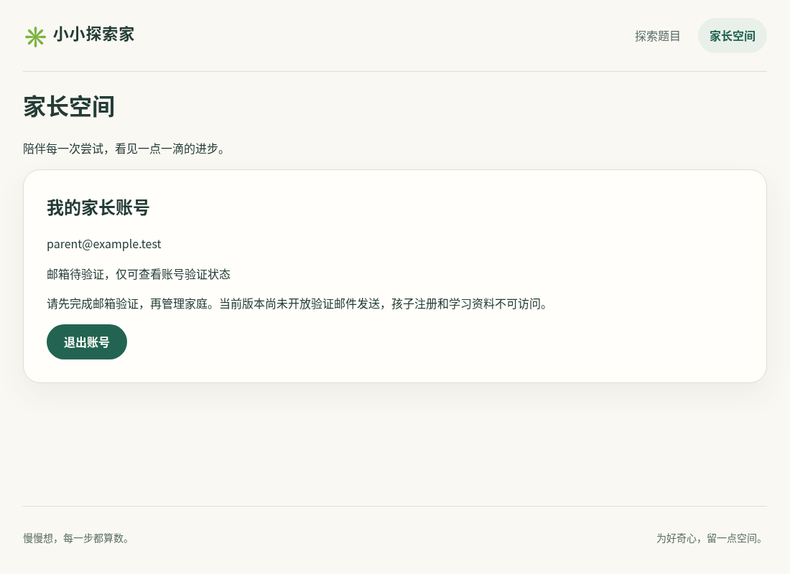
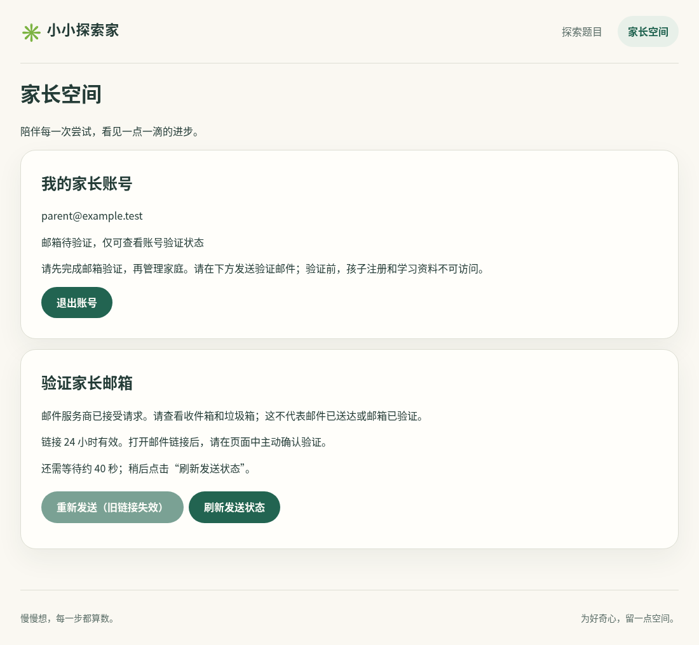
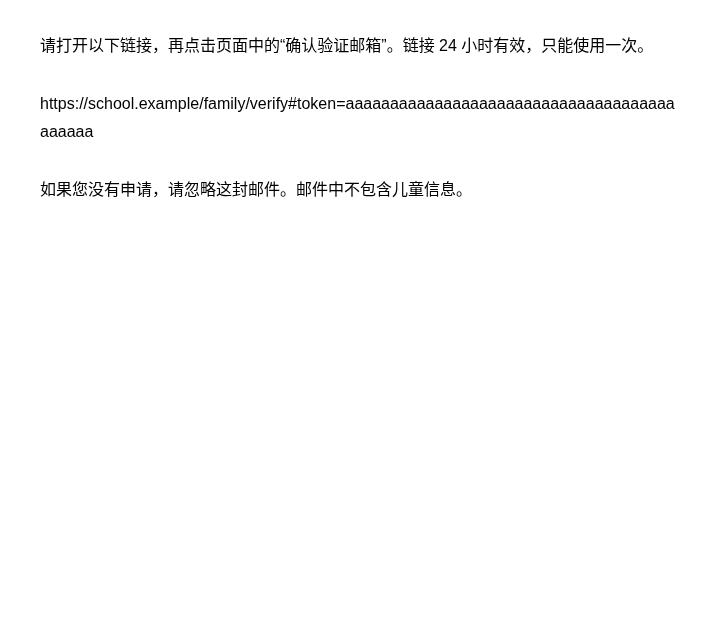
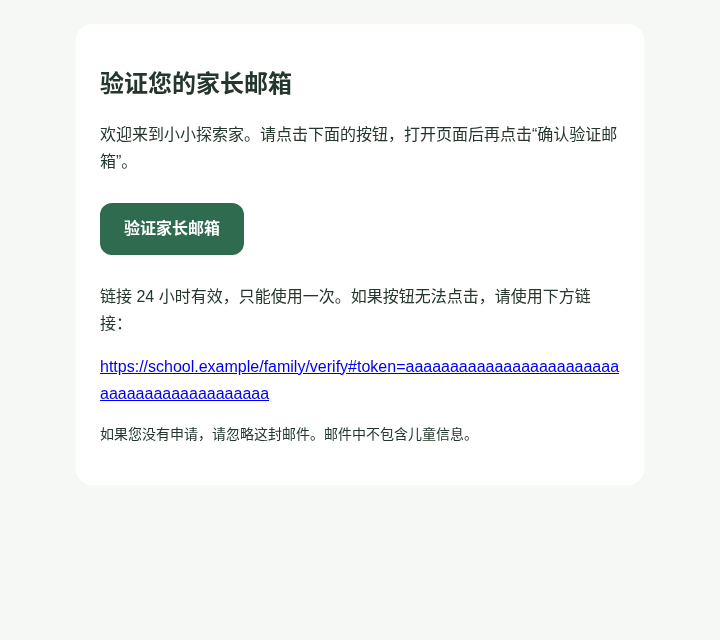

# #21 邮箱验证实施与验收

日期：2026-11-05。实现及邮件修正 PR #66/#68/#69 已合入 main；正式邮件验证部署 revision `ea6bc5ec7856b299746421cd0fb2090fb6b34deb` 已 READY，实际区域 Singapore（sin1）。维护者已确认收信、邮箱验证及重新登录后的 verified 权限，并接受按下列真实投递与自动化证据收尾 #21。

## Gmail 供应商说明

2026-11-05，维护者从以下 Google 官方页面复制并提供展开正文。开发环境访问 support.google.com 仍返回代理 403；下述是对维护者所提供正文的核对，不是独立联网抓取。

- [个人 Gmail 发信限制](https://support.google.com/mail/answer/22839)：单封邮件超过 500 个收件人，或一天发送超过 500 封邮件，可能触发发送限制；出现该限制后通常可在 1–24 小时内恢复。大量无效地址或退信也可能导致限制，恢复可能需 24 小时。收件方收信过快同样可能拒收。这些数字不是保证可用的吞吐量或送达承诺。
- [应用密码](https://support.google.com/accounts/answer/185833)：需要开启两步验证；密码长度 16 位。仅安全密钥的两步验证、组织账号或 Advanced Protection 等情况可能没有创建入口。Google 推荐支持时使用 Sign in with Google；当前 SMTP 适配器采用维护者选择的个人账号应用密码方式。
- 更改 Google 账号密码会撤销应用密码；手动 Remove 后同样失效。密码只能查看一次，遗失或撤销后需要生成新的应用密码，更新服务端 Secret 并重新部署；没有按月生成的要求。
- 网站自身仍限制每账号 5 次/滚动 24h、全站 50 次/滚动 24h 和 10 次/15 分钟，每次仅发往当前家长邮箱；全部计入共享数据库预算。发件账号若用于其他发信，其用量也会占 Google 额度。触发供应商限制时遵循失败状态与明确恢复流程，不绕过限制或后台盲目重试。

正式邮件配置包括 Variables 中的发件地址，以及 Secrets 中的应用密码和加密密钥。配置已通过正式发布校验，维护者已完成真实收信验证；值未进入仓库或日志。官方正文记录覆盖技术前置条件、额度及恢复说明，不代表 Google 批准具体业务用途、完整条款审计或持续免费。

## 账号流程

注册保存待验证账号，回执仍为 `mail: not-sent`。家长以自己的密码登录后，在家长空间主动发送验证邮件；重复匿名注册不会向已有账号发信或撤销有效链接。邮件只能发往当前登录账号邮箱，接口不接受客户端指定收件人。

验证链接使用可信 HTTPS `APP_ORIGIN`，令牌放在 fragment，进入页面后从地址栏清除，仅保留当前页面内存。GET/HEAD 不改变账号，点击“确认验证邮箱”后才同源 POST。令牌为 32 字节随机值，24 小时到期；数据库仅保存 SHA-256 哈希。条件更新与家长邮箱已验证标记在同一事务，父账号行锁串行化消费、重发与初次发送。仅证明邮箱归属，不发放登录 cookie；既有受限会话保持受限，重新输入密码登录后获得 verified 会话，家庭管理与儿童注册本身仍由后续任务实现。

## 投递与恢复

- 每个账号一条活动发送意图；发送前提交数据库。待重试令牌使用独立 32 字节 `MAIL_PAYLOAD_KEY` 做 AES-256-GCM 加密，并以意图编号绑定 AAD。不是长期明文 outbox。
- TLS SMTP 固定 `smtp.gmail.com:465`，校验证书，最低 TLS 1.2；连接/握手/空闲各有超时，单次发送总上限 12 秒。无供应商调试日志，无儿童信息、追踪像素或第三方页面资源。
- 状态区分 sending、accepted、retryable、rejected、authorization-failed、unknown、expired、verified。accepted 只表示 SMTP 接受；只有消费有效链接才标记邮箱已验证。
- 明确的暂时拒绝可由家长点击“安全重试”，沿用同一有效意图/令牌，总尝试最多三次。用户明确“重新发送”才生成新令牌并撤销旧链接。授权失败、永久拒绝、未知送达不能走安全重试。
- 真实本地 TLS SMTP 测试发现 Nodemailer 在 DATA 后断连也可能报告 CONN；无明确 SMTP 拒绝的 CONN 一律 unknown，避免重复发送。未知或被平台中止的发送，请先查收件箱；超过 60 秒的 sending 变为 unknown，绝不后台盲目重发。
- 共享 PostgreSQL 预算：账号冷却 60 秒、每账号滚动 24h 最多 5 次，全站滚动 24h 最多 50 次、15 分钟最多 10 次；包括安全重试，保守记入已预留但中断的尝试。这些是应用限额，不是 Google 官方额度。
- SMTP 接受、未知送达、永久失败、达到重试次数或链接消费后清除加密载荷；暂时拒绝才短期保留。过期/中断状态在账号访问时清理；staging 独立每小时维护任务也清理过期载荷，不依赖浏览器活动。GitHub schedule 可能延迟或失败，不承诺精确到期即物理删除；令牌有效性始终由数据库时间强制。维护任务不发邮件，失败需恢复后手动重跑。

## 本地证据

- 现有 49 项 API 测试在准备性重构前后通过。
- AES-GCM 篡改、错误密钥与错误意图绑定；服务先持久化再发送、同令牌重试、无效链接；HTTP 会话/CSRF、收件人注入、GET/HEAD 不消费、无登录 cookie；真实 TLS SMTP 授权撤销、421/550、DATA 451、DATA 断连和接受均覆盖。
- 隔离 PostgreSQL 17：并发只能消费一次，跨实例冷却，旧链接失效，三次上限，过期与中断恢复，受限会话不升级、重新密码登录获得 verified，维护清理及 Supabase anon/authenticated 无新表权限。
- 桌面/手机 Chromium：16 项功能测试通过。新页面投递状态使用合成 HTTP fixture，不将其算作真实 Gmail 或 Vercel 发信；原注册和会话路径使用隔离真实数据库。
- `npm run check` 通过（格式、lint、架构、TS7、测试、应用和 Storybook 构建）。随后新增总超时/全站预算回归并简化账号清理查询，API 全套 72 项、数据库 25 项以及对应 lint/typecheck 再次通过；前端 9 项、工具链 23 项通过。
- `npm run test:staging` 36 项通过；`npm run test:accounts` 6 项通过，独立容器、双实例、TLS 代理和数据库故障/恢复场景完成；`npx --no-install jscpd .` 0 clones。`npm audit --omit=dev` 0 已知生产依赖漏洞。
- 未执行的供应商或生产测试不能以本地测试替代。未安装独立 simplify/code-review/security-review 技能，已按项目命令与 REVIEW.md 手工做对应简化、代码和安全审查；不把它报告为自动 AI 审查。视觉已人工检查本地合成截图，没有冒充像素级视觉回归基准。

## 界面

同一合成账号的本地截图，无真实家长数据。

| 改动前                                | 改动后                               |
| ------------------------------------- | ------------------------------------ |
|  |  |

## 验证邮件界面

邮件包含 HTML 和纯文本两种格式；HTML 使用“验证家长邮箱”按钮及完整网址链接，二者与纯文本中的 URL 一致，令牌仍在 fragment。没有外部图片、脚本、样式资源或追踪像素。打开链接后仍需在网站主动确认，邮件按钮不直接消费令牌。

以下是相同合成数据的本地邮件预览，不是 126 实际客户端截图；桌面和 375px 手机 Chromium 检查了链接目标和横向溢出，真实 TLS SMTP 检查 multipart/alternative 包含 text/plain 和 text/html。

| 纯文本预览                         | HTML 预览                             |
| ---------------------------------- | ------------------------------------- |
|  |  |

## 正式 staging 验收

- PR #66 提供正式验证与持久化投递，PR #67 记录官方供应商说明，PR #68 将发件地址归入 Variables，PR #69 提供 HTML 按钮和纯文本版本。
- main `ea6bc5ec7856b299746421cd0fb2090fb6b34deb` 的 CI 运行 [42030732490](https://github.com/juanchaopan/education/actions/runs/42030732490) 成功；staging 运行 [42030621281](https://github.com/juanchaopan/education/actions/runs/42030621281) 完成迁移、账号冒烟与推广。稳定域名 `education-access-spike.hyp.app` 读回 deployment `dpl_GEL6D2RqDWt1EaDYcjfkN4TXTj2Z`，READY、sin1、revision 与 main 一致。
- 维护者使用自己控制的 126 邮箱，完成注册、密码登录、主动发送验证邮件、收信、使用验证链接及重新登录。页面明确显示“邮箱已验证”和“您已安全登录。家庭管理和孩子注册将在后续版本开放。”；对应 verified 会话，不是仅凭 SMTP accepted 显示成功。
- 已用链接的浏览器复用未执行。维护者表示账号已验证、接受现有测试证据并要求创建收尾 PR；单次/并发消费、过期及重发失效由已通过的真实 PostgreSQL 测试覆盖，不把浏览器复用记为实测通过。
- 正式 staging 过期邮件清理手动运行 [42031753030](https://github.com/juanchaopan/education/actions/runs/42031753030) 成功，使用既有专用数据库与 TLS 校验；只清理到期载荷及到期发信预算记录，不发信、不删除账号。一次手动成功不证明定时任务准时执行，仍需监控小时维护任务。
- 本次没有记录收件箱分类或精确投递耗时，不从 #16 的旧测试复制这些结果。收件地址、密码、真实令牌和邮件原文不进入验收文档。
- 授权撤销、4xx/5xx、超时、DATA 后断连等恢复证据来自本地真实 TLS SMTP 的受控失败，以及数据库/HTTP 测试；没有主动耗尽 Gmail 配额、撤销正式凭据或破坏已验证账号来制造故障。

## 后续边界

- #22 实现家长密码恢复和旧会话撤销；#23 起实现家庭 KEY 与儿童账号。邮箱验证只开放 verified 账号权限，不能将后续家庭管理功能报告为已实现。
- #51 验收真实大陆设备的整个链路，#52 人工生产发布。当前不声称大陆全网可达、Google 持续免费、完整家庭功能或生产已上线。
