# #218 菜园变化题按逐幕探究做：样稿和实现

[#218](https://github.com/juanchaopan/education/issues/218) 的样稿和实现截图。菜园题的变化题按手册[逐幕探究](../../design/interactive-lesson-authoring.md#逐幕探究)的顺序做：先猜、再换、说理由，最后揭晓；孩子作答之前，旁白和画面都不说出答案。样稿画的是作答胶囊的新状态、说理由时的两排点选、变化题的结论板，以及变化题各幕在电脑和竖拿的手机上的样子；实现截图是对应的 Storybook story 的视觉基准。

## 样稿

样稿是一次性的 HTML：在 Storybook 里打开菜园题的 story，按变化题每一幕的状态摆好天平和篮子，再把真实的工具、萤火虫提示、话筒和作答胶囊放进画面。作答胶囊已有的状态（麦克风在听、「我听到 6 根」、「再说一次」）就是现有的部件；新的状态（「记下了」、「我听到你说」、两排点选）和「那么」结果条借用作答胶囊和结论板的样式画出来。动画都停在结束的样子，只有「看这里」的虚线光圈停在最亮的时候。字幕里是这一幕的台词。

变化题是另一道题，所以结论板只放变化题的条件：揭晓前两条，「1 棵青菜 = 3 个苹果」（变化题还要用、没变的那条）和「假如 1 个苹果 = 2 根黄瓜」；揭晓后加上第三条「那么 1 棵青菜 = 3 组 = 6 根黄瓜」，画成一棵青菜、等号、三个框，每框两根黄瓜。「假如」「那么」角标画在金色光圈上面。画面里没有说出答案的纸条；篮子上的「一个苹果换两根」是新条件，留在画面上。

放进题目画面里的样子，电脑横屏（1280×720）：

| 幕和状态                                                                              | 样稿                                       |
| ------------------------------------------------------------------------------------- | ------------------------------------------ |
| 猜：旁白说出新条件后响提示音，麦克风自己打开；苹果不亮、不能点                        | 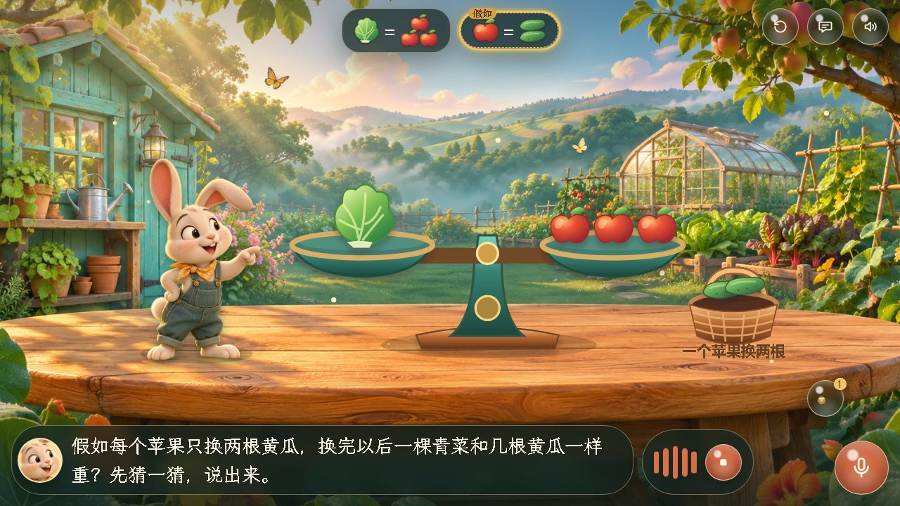 |
| 猜：「我听到 6 根」，旁边是绿色的对和蜜黄的重说                                       | 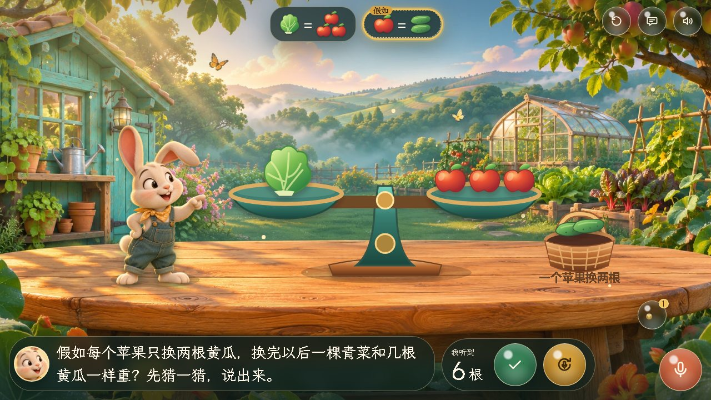     |
| 猜：确认后「记下了」加「6 根」，不说对错，约 1.5 秒后自己进下一幕，猜的数不留在画面上 |   |
| 换：苹果带「看这里」的光圈，点一下换成一组两根；旁白不说总数                          | 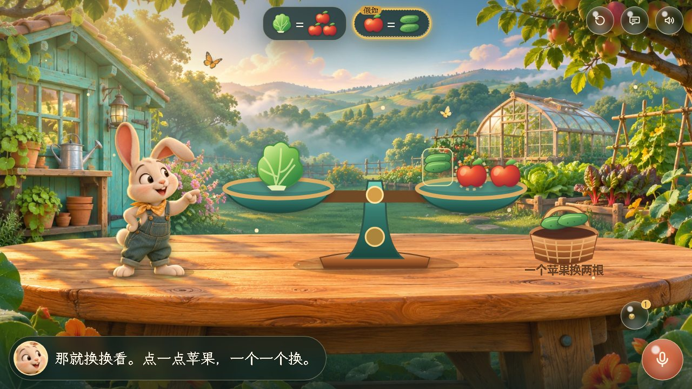            |
| 说理由：「我听到你说：『……』」和对、重说                                              | 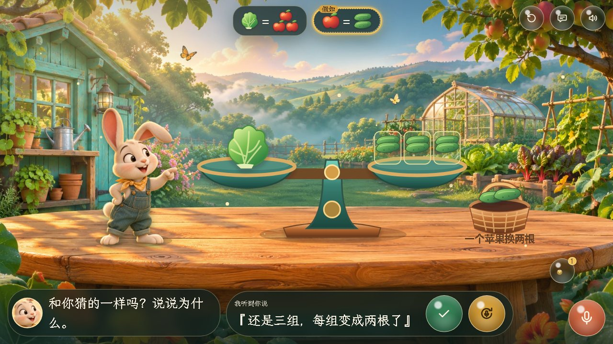    |
| 说理由：说不了话或连说两次判不出时，两排点选和一个「交」                              | 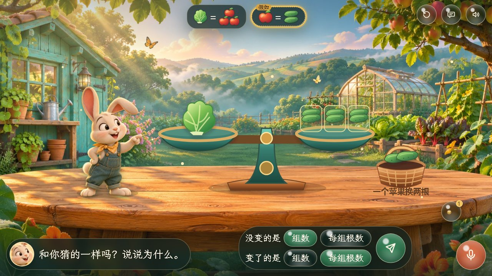  |
| 说理由：没说清，只有字幕和「再说一次」，萤火虫露珠照常待命                            | 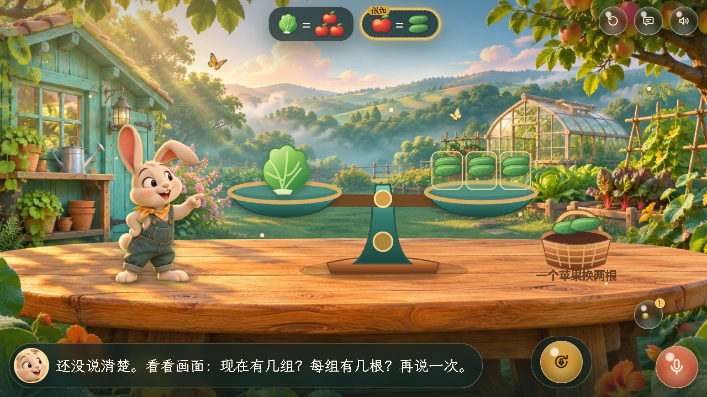  |
| 揭晓：板上三条，第三条是带「那么」角标的结果                                          | 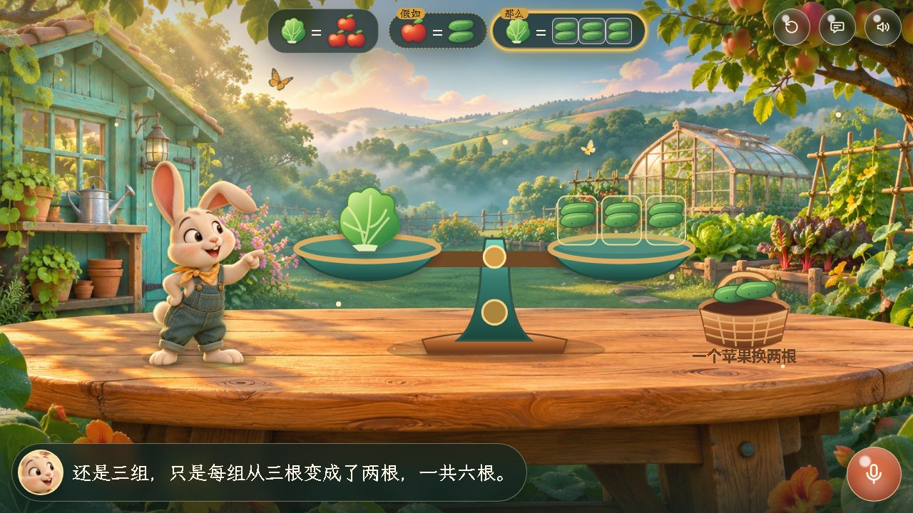          |

竖拿的手机（390×844），每张图上面写着是哪一步：

| 幕                               | 样稿                            |
| -------------------------------- | ------------------------------- |
| 猜和换                           | 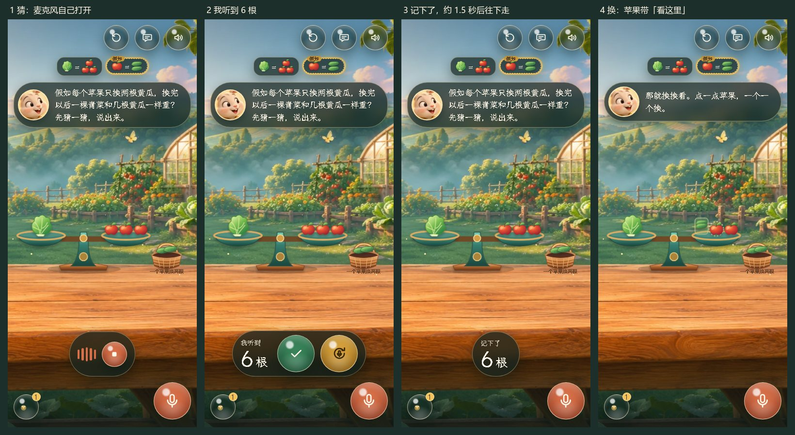  |
| 说理由                           | 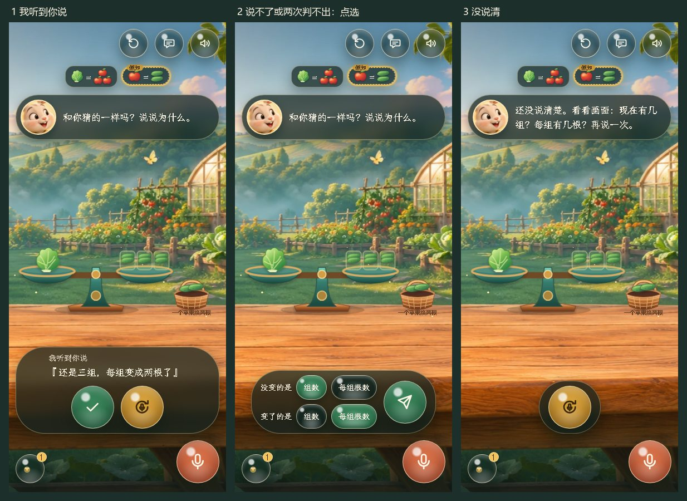 |
| 揭晓，板上三条，「那么」条在最后 | 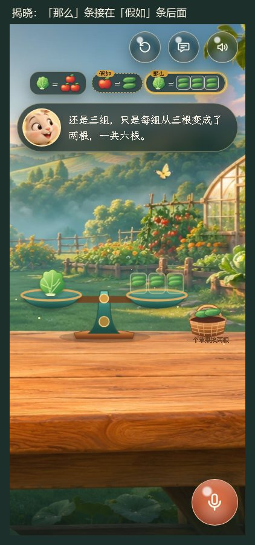 |

几种画法并排，金框是维护者选定的：

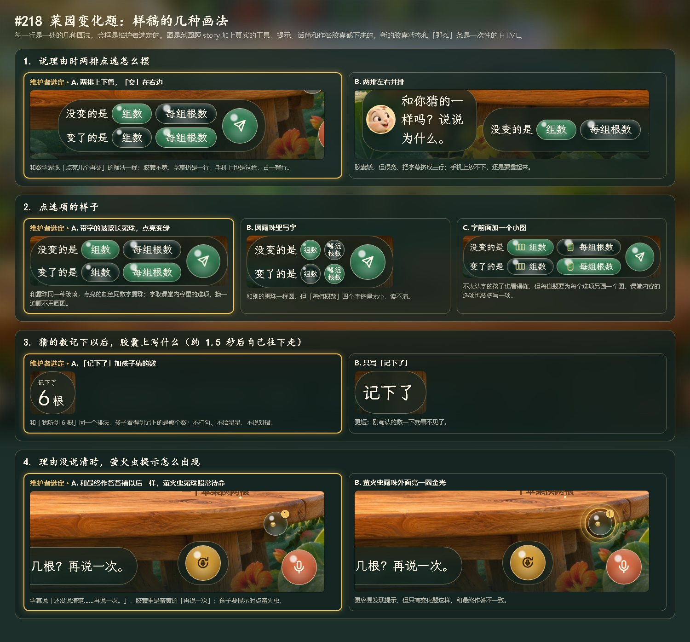

## 维护者的选择

2026-11-14 的决定（见 issue 的评论），样稿照着画：

- 猜的数走普通的作答胶囊：「我听到 6 根」→ 对 →「记下了」，不说对错；约 1.5 秒后自己往下走，没有「接着看」，猜的数不留在画面上，也没有猜数专用的控件。
- 台词：「假如每个苹果只换两根黄瓜，换完以后一棵青菜和几根黄瓜一样重？先猜一猜，说出来。」「那就换换看。点一点苹果，一个一个换。」
- 说理由时两排露珠点选同时出现：「没变的是」「变了的是」，每排是「组数」「每组根数」，旁边一个「交」。
- 理由没说清只用字幕「还没说清楚。看看画面：现在有几组？每组有几根？再说一次。」，加萤火虫提示。
- 揭晓以后的结果「1 棵青菜 = 3 组 = 6 根黄瓜」单独一条，蜜黄实线框，带「那么」角标（和「假如」对应），按 [#239](../239/README.md) 的结论板画法画成一棵青菜、等号、三个框，每框两根黄瓜；读屏读整句。

2026-11-15 看过样稿以后的决定：

- 变化题是另一道题。进入变化题以后，结论板收起原题的结论，只放变化题的条件：「1 棵青菜 = 3 个苹果」和「假如 1 个苹果 = 2 根黄瓜」；揭晓以后加上「那么 1 棵青菜 = 3 组 = 6 根黄瓜」（三框、每框两根）。这是所有课的通用规则，写进手册的逐幕探究和课堂公共部件，由结论板组件统一做，模板的变化题也一样。
- 变化题结束以后，板上保持变化题的样子直到课结束。提问的老师拿到的材料也把原题的结论和变化题的条件、结果分开，结果从揭晓那一幕起才有。
- 说理由的两排点选上下叠、「交」在右边，选项是带字的玻璃长露珠，点亮变绿。
- 猜的数记下以后，胶囊写「记下了」加孩子猜的数（如「6 根」），和「我听到 6 根」同一个排法；不打勾、不给星星、不说对错。
- 理由没说清时，萤火虫露珠照常待命，和最终作答答错以后一样。
- 亮着的结论条，「假如」「那么」角标画在金色光圈上面。

## 实现

实现截图来自 `apps/web/src/features/learning/components/garden-balance/garden-scenes.stories.tsx` 里变化题的几个 story（Learning/Garden balance / Variation…），和视觉测试的基准是同一批图。作答胶囊、说理由的胶囊和结论板各自的 story 在 Learning/Answer capsule（Guess recorded）、Learning/Reason capsule 和 Learning/Lesson stage/Conclusion board（Variation、Wrapping）。

电脑横屏，左边样稿、右边实现：

| 幕和状态                           | 样稿                                      | 实现                                        |
| ---------------------------------- | ----------------------------------------- | ------------------------------------------- |
| 猜：「我听到 6 根」                |     | 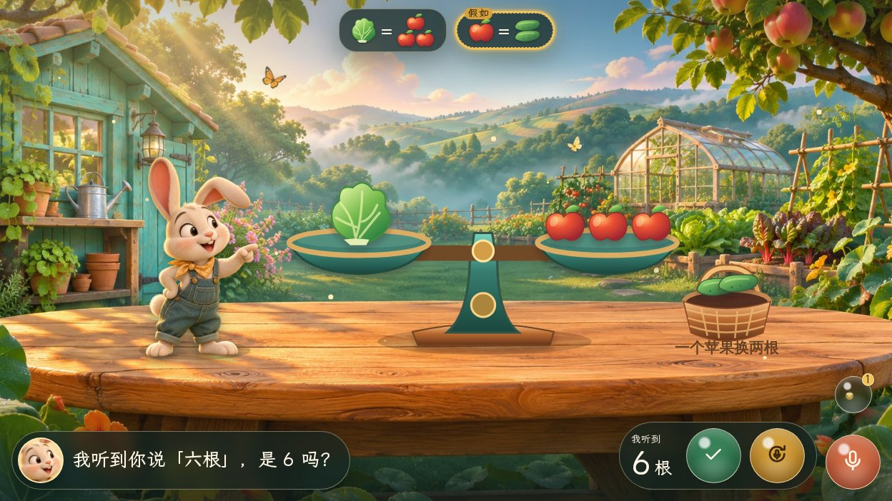    |
| 猜：「记下了」加「6 根」           |  | 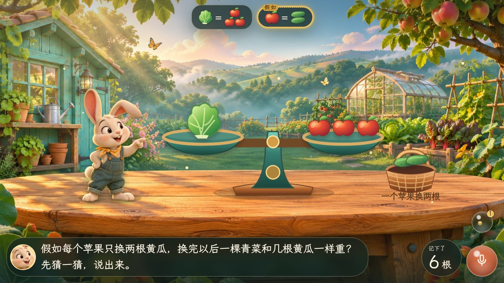 |
| 换                                 |            | 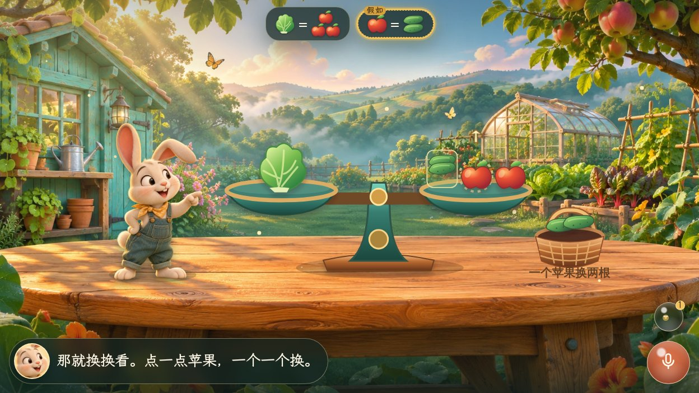           |
| 说理由：「我听到你说：『……』」     |    | 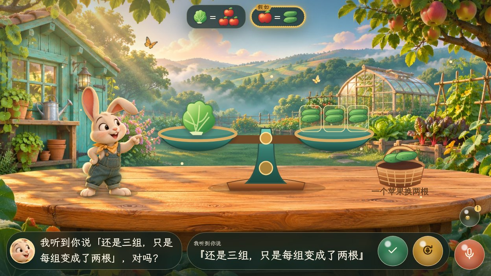   |
| 说理由：两排点选和「交」           |  | 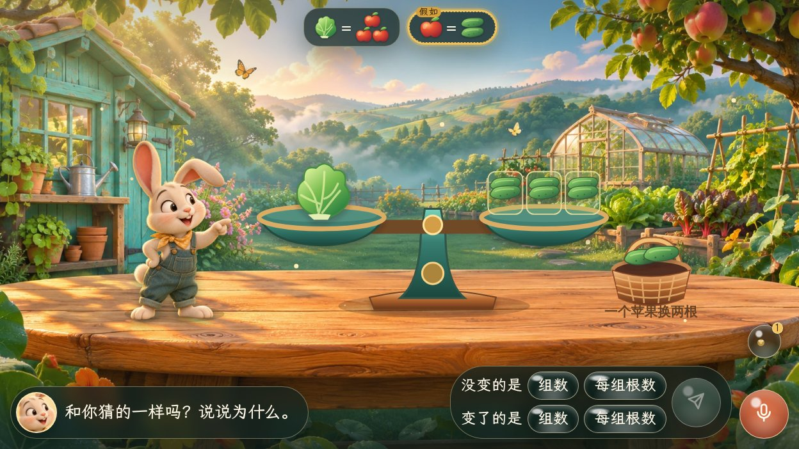 |
| 说理由：没说清，字幕和「再说一次」 |  | 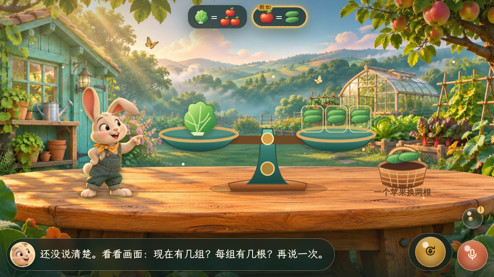 |
| 揭晓：「那么」条在「假如」条后面   |          | 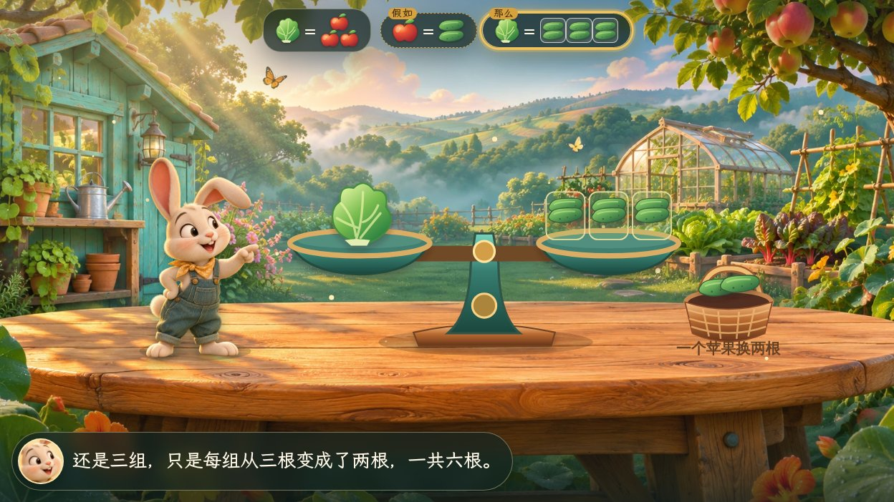         |

竖拿的手机，左边样稿、右边实现：

| 幕     | 样稿                            | 实现                              |
| ------ | ------------------------------- | --------------------------------- |
| 说理由 |  | 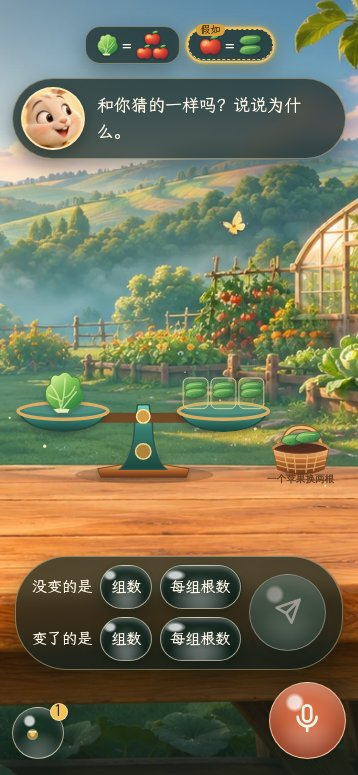 |
| 揭晓   |  | 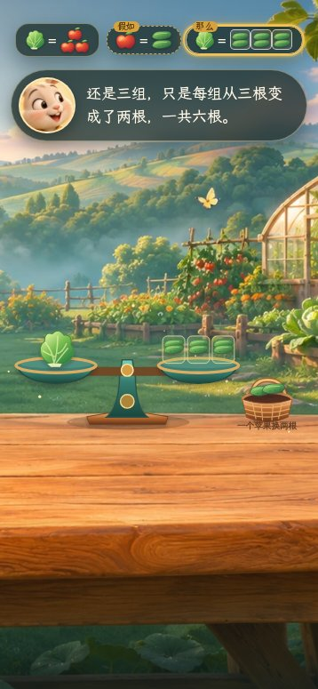 |

和样稿不同的地方：

- 换的那一幕，样稿里「看这里」的虚线光圈停在最亮的时候；实现的截图停在动画开始，光圈很淡。
- 说理由的点选在竖拿的手机上，题目「没变的是」「变了的是」和带字的露珠比电脑上小一号，两排和「交」放得进一屏宽。

新题模板的变化题（三颗石子）没有画样稿，按同一套胶囊、点选和结论规则做：猜、把三颗小石子一颗一颗放进碗里、说理由（点选「一颗一颗地放」「石子的颗数」）、揭晓「还是一颗一颗地放，只是多了一颗，一共三颗。」
