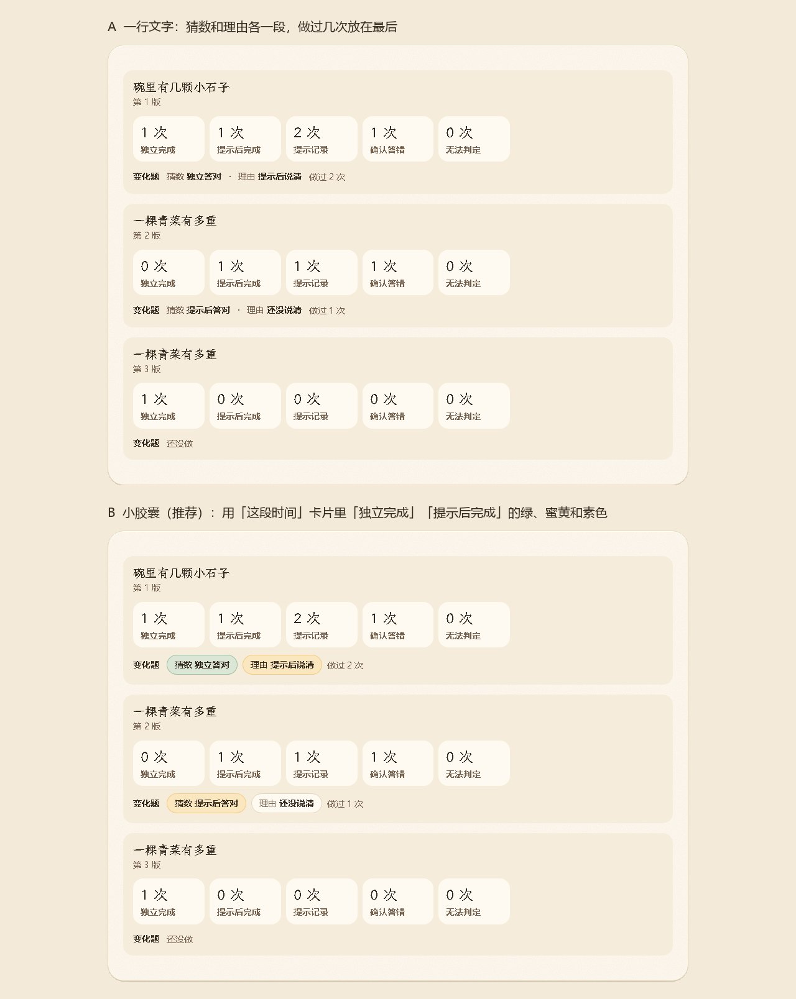
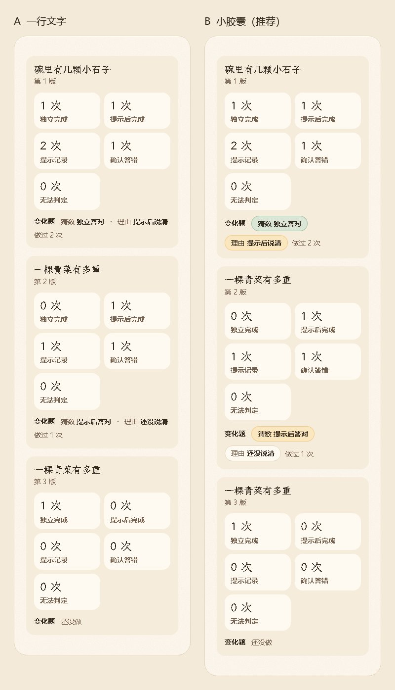
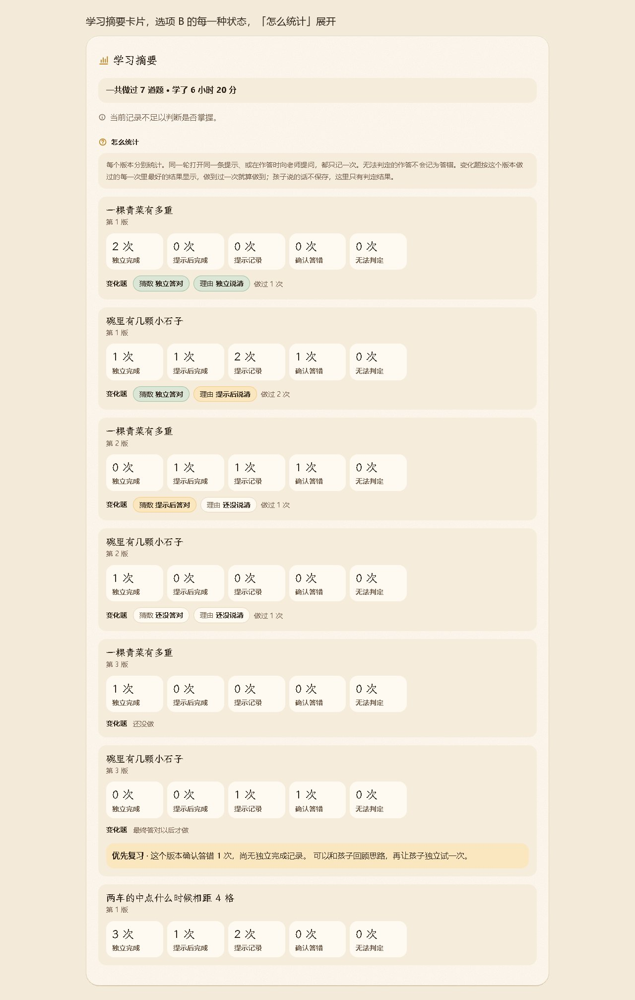
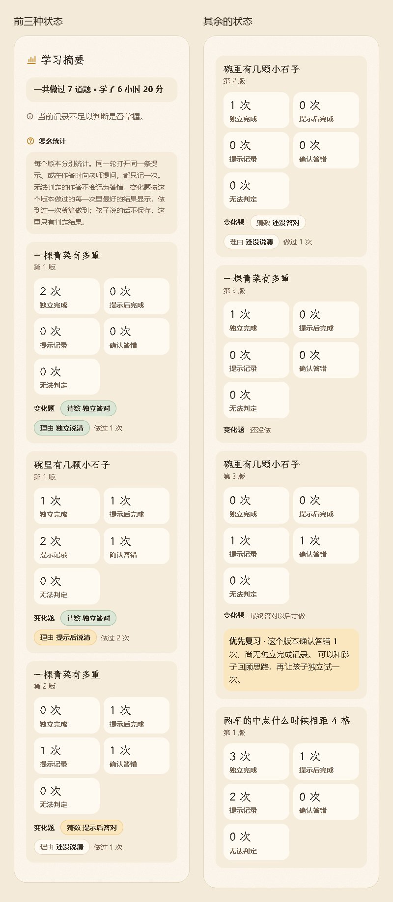

# #219 家长学习摘要里的变化题结果：样稿

[#219](https://github.com/juanchaopan/education/issues/219) 的样稿。维护者 2026-11-15 看过以后定了新的方向，#219 由 [#255](https://github.com/juanchaopan/education/issues/255) 接替。这份记录留着两样东西：维护者选定的小胶囊样子（下面的 B），和 2026-11-14 照当时的决定画的样稿。

## 维护者 2026-11-15 的方向

- 学习摘要按题列，每道题一项，显示孩子做过的编号最大的版本的结果；按版本的详情页列出这道题的全部版本。
- 结果只分独立完成、提示后完成、还没完成三种，不列次数；原题看最终答案，变化题分猜数和理由。
- 下面「2026-11-14 的决定」里的每一行一个版本、「做过 2 次」、「独立答对」「独立说清」这几套词、「最终答对以后才做」都由这个方向取代，规则见 [题目的版本](../../design/problem-versions.md)，变更原因见 [变更记录](../../changes/2026-11-15-problem-versions-summary.md)。
- 沿用的是画法 B：独立是绿、提示后是蜜黄、还没是素色的小胶囊。

## 怎么做的

样稿用真实的 `LearningSummaryList` 画：在 Storybook 开发服务器里打开 Family/LearningSummary 的 story，一次性脚本把里面的题目格复制成每种状态一格，改上题名和数字，在统计格下面加一行变化题，再给列表套一张和家长空间学习摘要卡片一样的卡片，用 Playwright 的 Chromium 截图：桌面 1280 宽，手机 390 宽，减弱动画。样稿代码不进入仓库。

和正式页面的差别：

- 变化题这一行是样稿脚本里的 CSS，只用网站的设计令牌。
- 统计格、题目格、「怎么统计」、卡片和 7 题的累计都是 2026-11-14 页面上的样子，题名和数字是样稿用的例子。
- 每张图只画学习摘要卡片，不画侧栏、选孩子的胶囊和「这段时间」卡片；手机图里的卡片宽 358px，是 390px 屏幕减去左右各 16px。

## 2026-11-14 的决定

样稿照着画（已由上面 2026-11-15 的方向取代）：

- 每一行是一道题的一个版本。变化题那一行放在这道题统计格的下面、优先复习的黄色条的上面。
- 内容取这个版本所有尝试里最好的结果：「变化题　猜数 独立答对 · 理由 提示后说清　做过 2 次」。猜数是独立答对、提示后答对、还没答对；理由是独立说清、提示后说清、还没说清。
- 还没做是「变化题　还没做」，最终答案还没答对是「变化题　最终答对以后才做」，没有变化题的题不显示这一行。
- 「怎么统计」加一句：「变化题按这个版本做过的每一次里最好的结果显示，做到过一次就算做到；孩子说的话不保存，这里只有判定结果。」
- 只改学习摘要卡片；总览卡片、「这段时间」的数字和家庭导出不变。

## 样稿里的状态

题目格里的行，从上到下：

| 行                                      | 变化题那一行                               |
| --------------------------------------- | ------------------------------------------ |
| 一棵青菜有多重 第 1 版，独立完成 2 次   | 猜数 独立答对 · 理由 独立说清　做过 1 次   |
| 碗里有几颗小石子 第 1 版                | 猜数 独立答对 · 理由 提示后说清　做过 2 次 |
| 一棵青菜有多重 第 2 版                  | 猜数 提示后答对 · 理由 还没说清　做过 1 次 |
| 碗里有几颗小石子 第 2 版                | 猜数 还没答对 · 理由 还没说清　做过 1 次   |
| 一棵青菜有多重 第 3 版，已独立完成 1 次 | 还没做                                     |
| 碗里有几颗小石子 第 3 版，确认答错 1 次 | 最终答对以后才做，下面接着优先复习的黄色条 |
| 两车的中点什么时候相距 4 格 第 1 版     | 没有这一行                                 |

## 这一行画成一行字还是小胶囊

两种画法内容一样，手机上都按段换行，「猜数 独立答对」「理由 提示后说清」每一段不会从中间断开。

|     | 画法                                                                                                                                                                                                                                            |
| --- | ----------------------------------------------------------------------------------------------------------------------------------------------------------------------------------------------------------------------------------------------- |
| A   | 一行小字：「变化题」加粗，猜数和理由的结果加粗，中间一个圆点，「做过 2 次」放在最后，用次要文字色。比统计格安静，但一眼看不出哪一道是独立做到的                                                                                                 |
| B   | 维护者 2026-11-15 选定。「变化题」加粗，后面猜数和理由各一枚小胶囊：独立是绿，提示后是蜜黄，还没做到是素色，样子和「这段时间」卡片里每道题右边的「独立完成」「提示后完成」「还没做出来」一样；「做过 2 次」放在后面。颜色只是呼应，字写明了结果 |

选 B 的理由：家长往下翻一页二十道题时，用颜色就能分出哪些已经独立做到；用的是网站已有的状态胶囊，没有新的视觉元素。

| 截图                               | 画的是什么                                               |
| ---------------------------------- | -------------------------------------------------------- |
|  | 桌面，A 在上、B 在下：提示后说清、一半没做到、还没做三种 |
|    | 手机，A 在左、B 在右：同样三种                           |

## 画法 B 下的每一种状态

| 截图                              | 画的是什么                                                                                                                       |
| --------------------------------- | -------------------------------------------------------------------------------------------------------------------------------- |
|  | 桌面，上面的七种状态，卡片最上面的累计，「怎么统计」展开，里面是加上的那一句                                                     |
|    | 手机，左边一列是前三种和展开的「怎么统计」，右边一列是其余几种；最终答对以后才做那一格带着优先复习的黄色条，最后是没有变化题的题 |

## 样稿里看出的几处

这几处促成了 2026-11-15 的方向：

- 一格里有三套近义的词：统计格的「独立完成」「提示后完成」（最终作答）、猜数的「独立答对」「提示后答对」、理由的「独立说清」「提示后说清」。
- 统计格里有「无法判定」，变化题这一行不显示它，因为猜数和理由判不出来时什么都不记；两处的意思不同。
- 「做过 2 次」是这个版本变化题的轮数，紧挨着统计格里的「2 次」时，可能被当成最终作答的次数。
- 猜数和理由各取所有轮里最好的，所以「猜数 独立答对 · 理由 提示后说清　做过 2 次」可能来自不同的两轮。
- 手机上统计格排成两列、五格占三行，变化题这一行在统计格下面再占两行，一个版本的格子更高；同一道题的几个版本各占一格，二十道题一页，往下翻更长。
