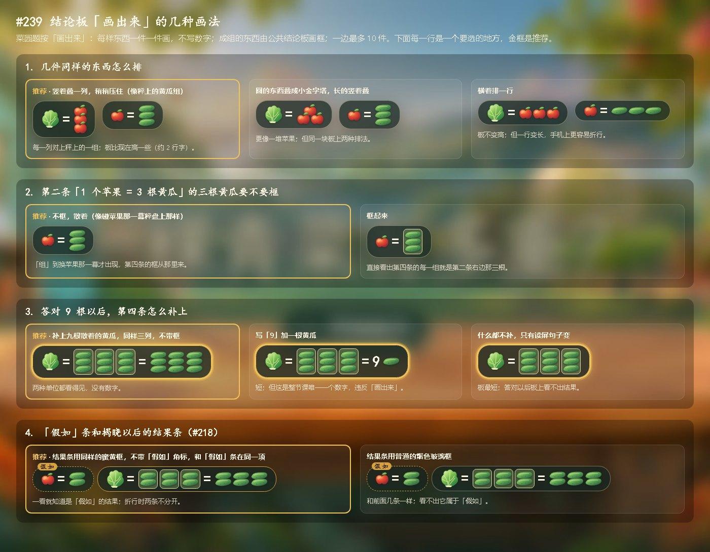
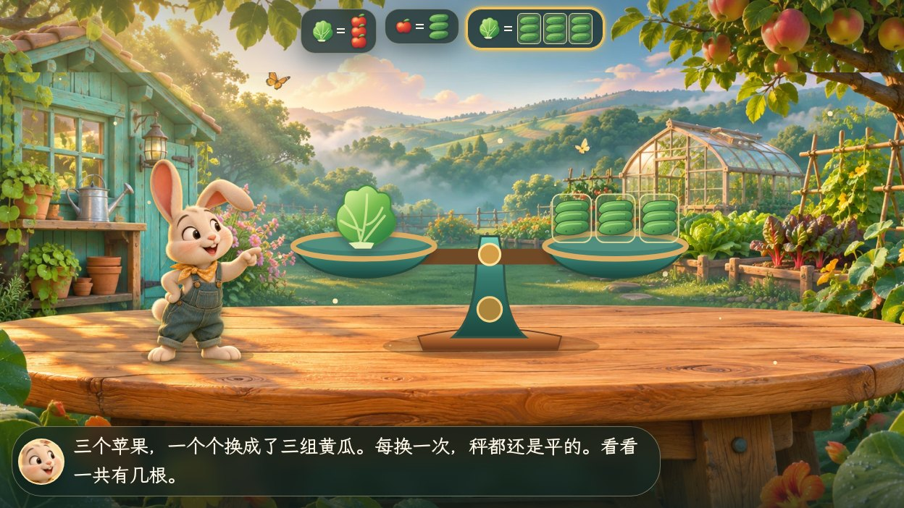
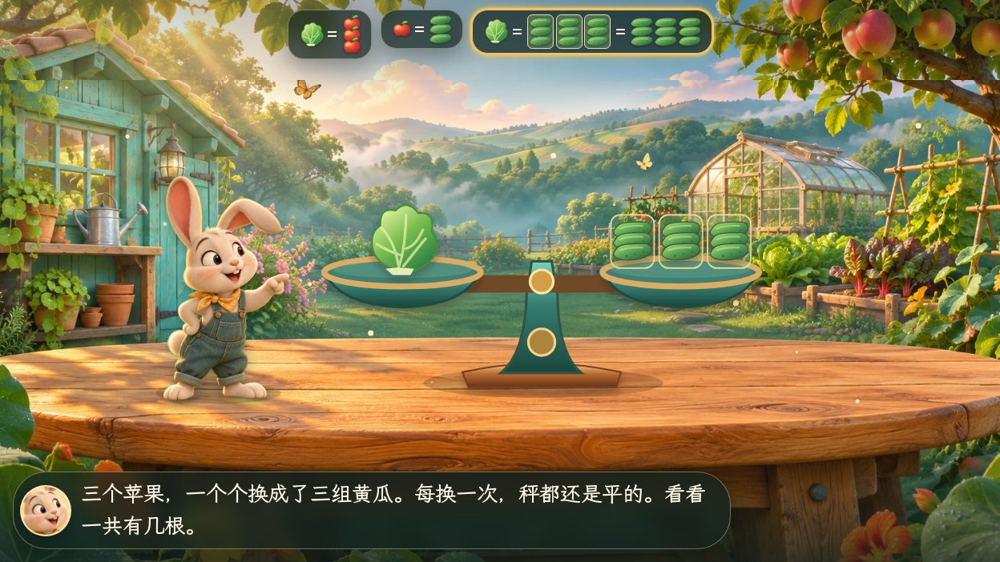
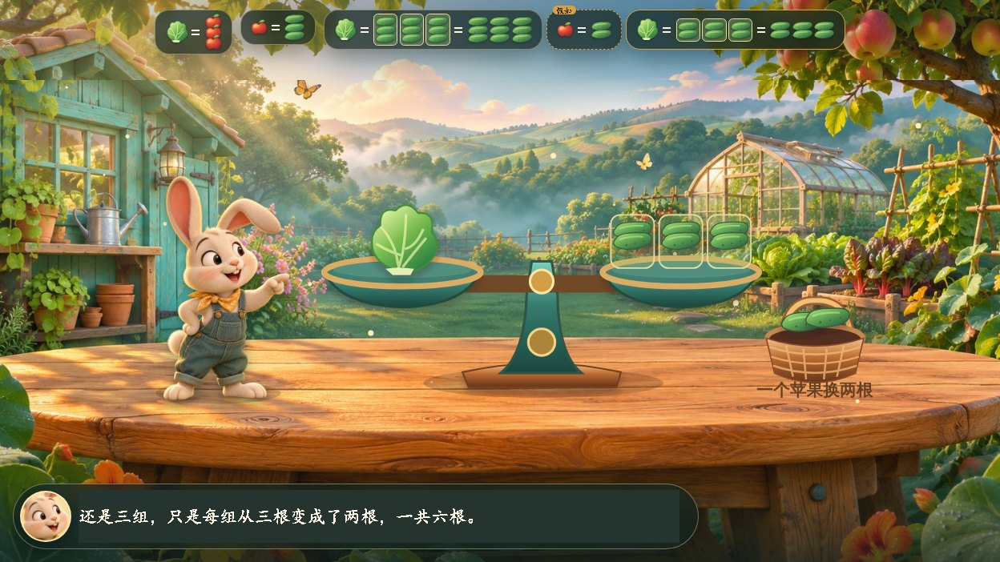
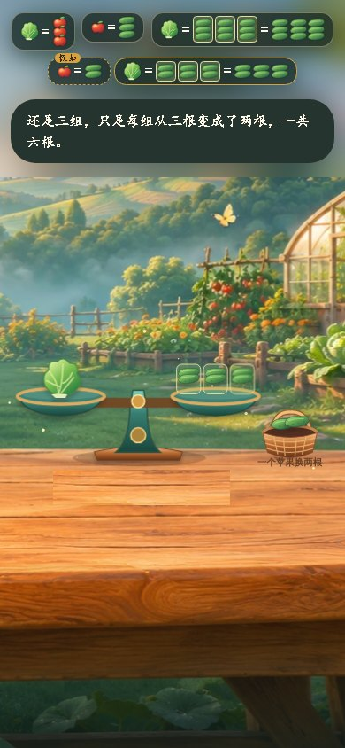
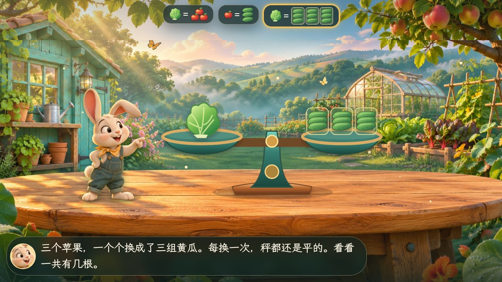
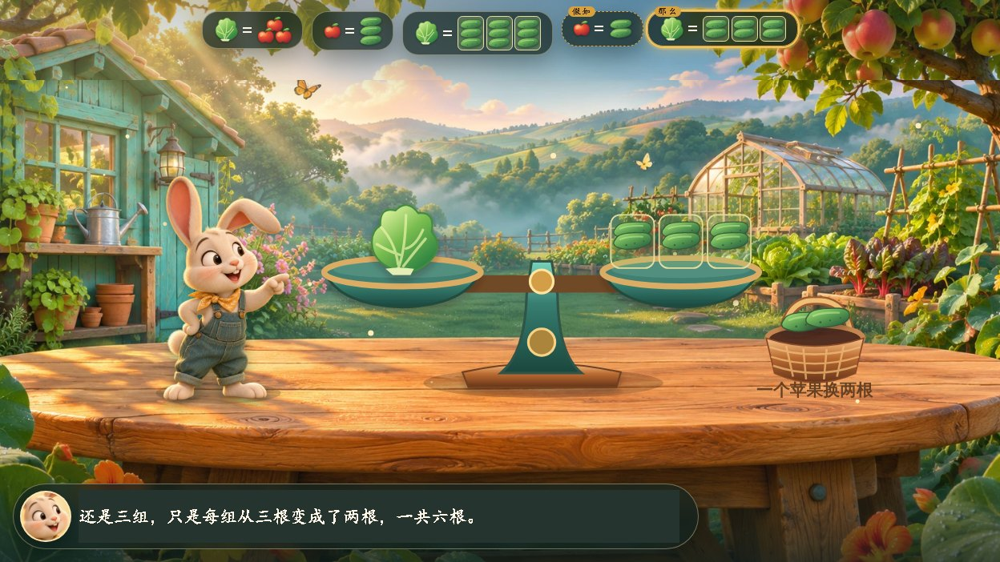
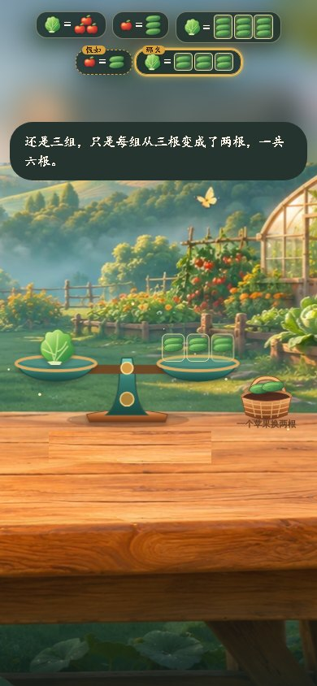

# #239 结论板画成东西：样稿和维护者的选择

[#239](https://github.com/juanchaopan/education/issues/239) 的样稿和维护者的选择。结论板上的量用题目的道具画出来，不写数字加小图；手册的[结论前后一致](../../design/interactive-lesson-authoring.md#结论前后一致)和课堂公共部件的[结论板](../../design/lesson-kit.md#结论板)按这里的选择写。

## 样稿

样稿是一次性的 HTML，底图是菜园题 story 的视觉基准截图，字体用系统楷体代替霞鹜文楷。桌面的几张顶上能看到一道接缝，手机的那张顶部是模糊的：这是样稿把结论板贴到底图上留下的痕迹，不是要实现的样子。

几种画法并排，每一行是一个要选的地方，金框是推荐：

放进题目画面里的样子：

| 状态                                             | 样稿                                     |
| ------------------------------------------------ | ---------------------------------------- |
| 桌面，作答那一幕，答对之前                       |  |
| 桌面，作答那一幕，答对以后                       |   |
| 桌面，变化题揭晓以后，顺带画了 #218 的结果条     |         |
| 手机竖屏，变化题揭晓以后，顺带画了 #218 的结果条 |           |

## 维护者的选择

2026-11-14，开发前：

- 画法的规则只管结论板；六年级数轴追及题的推导板照旧写算式。「同一个叫法、同一个量词、说法一致」的规则管所有课。
- 盲测：手册提交之后，新开 agent，只给 issue 里的原句提示；检查它的记录里有没有偷看 issue；通过就采用它的改动。

2026-11-14，看过样稿以后，取代开发前「每节课只定一种画法、一边最多 10 件」的说法：

- 手册写原则，菜园题只是例子；逐幕探究的结论不一定是数字，不为数字这一种情况定公式。
- 前后一致：同一样东西整节课同一张图、同一个叫法和量词；结论板、旁白、字幕和画面说法一致。
- 能画就画：数量小直接画出来，不写 1、2、3；画出来太高或太宽时，在单个东西或一组前面写「k×」（大约 8 件以内都能直接画）。
- 往后看着画：先看整节课的结论再定画法，前面怎么画要让后面的结论对得上。例：1 个苹果 = 8 根香蕉、1 个榴莲 = 2 个苹果时，榴莲那边画「2×」一组 8 根香蕉；但如果 1 个榴莲 = 8 个苹果，后面会出现 64 根香蕉，前面就要画成「榴莲 = 8×苹果」。
- 摆法看情况：两件可横可竖，三个圆的东西摆成三角，长的东西叠成一列，四件 2×2，五件 3+2；高度不能太高，宽度要好看，整块板尽量不折成好几行。由作者定，审查时看高宽。
- 菜园题各条怎样画，维护者在样稿上逐项选定，选定的样子见下面三张图。
- #218 揭晓后的结果条：蜜黄框，带「那么」角标（和「假如」对应），紧接在「假如」条后面。

## 选定的样子

和上面的样稿一样是一次性的 HTML，接缝和模糊的顶部同上。两张揭晓以后的图顺带预览 #218 的结果条和它的「那么」角标。

| 状态                     | 图                             |
| ------------------------ | ------------------------------ |
| 桌面，作答那一幕         |  |
| 桌面，变化题揭晓以后     |  |
| 手机竖屏，变化题揭晓以后 |    |

## 样稿和实现对照

对照随实现一起补上。
