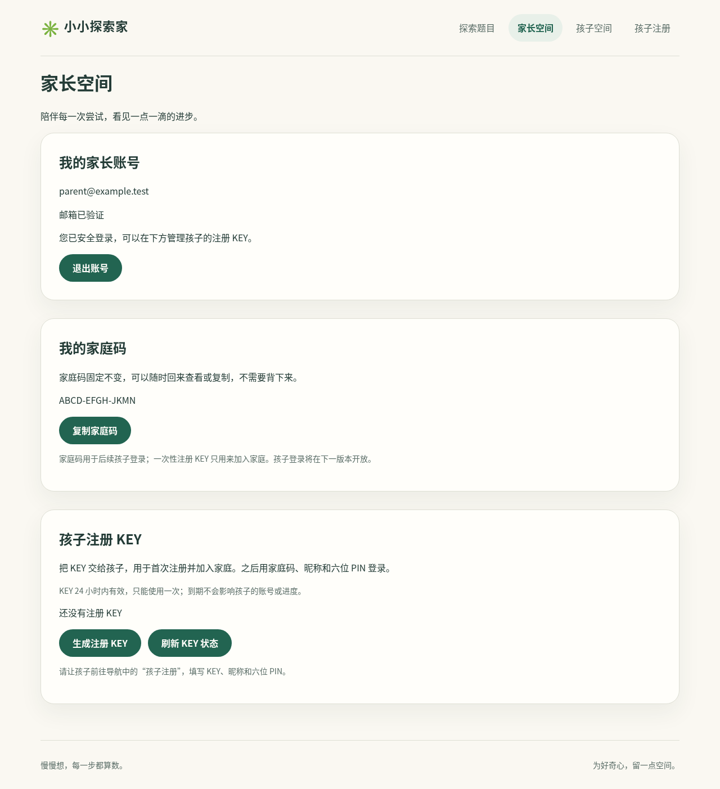
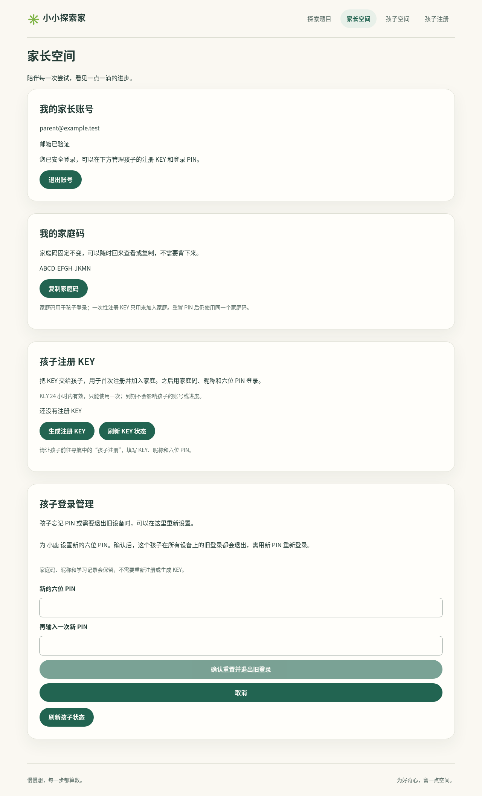
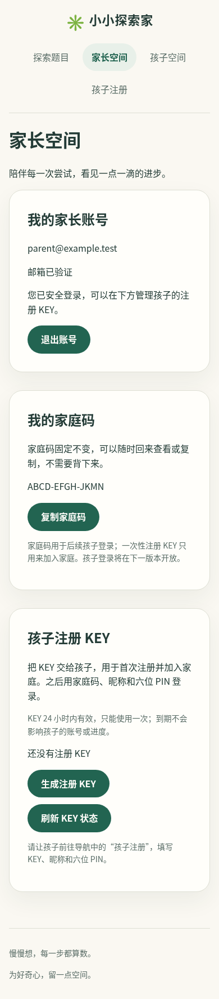
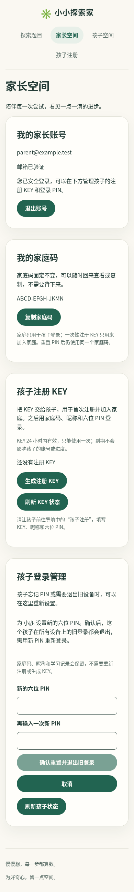

# #26 家长重置儿童访问

本轮实现尚待 PR 的 CI、维护者审查、合并与 Singapore staging 真实浏览器验收；不能据本地结果关闭 #26 或声称已经发布。

## 行为与边界

- `/family` 的“孩子登录管理”读取当前已验证家长所属家庭的儿童，不接受客户端家庭选择。列表只返回孩子 ID、昵称和凭据版本，不返回 PIN、哈希或会话。
- 最近五分钟家长密码验证后，选孩子、两次输入新六位 PIN，再明确确认重置及所有旧设备登录退出。复用现有重认证接口，新的 PIN 遵守注册校验；拒绝沿用旧 PIN。
- `POST /api/v1/parents/children/reset-pin` 绑定当前安全 cookie、同源 JSON、自定义请求头和 CSRF。家长身份、家庭、会话版本、邮箱权限、到期与近期验证均由数据库复核。
- 事务锁顺序为家长 → 家庭 → 家长会话 → 儿童 → 儿童会话。更新身份绑定 HMAC + Argon2id PIN、递增儿童凭据版本、撤销其所有旧会话、清除该孩子的登录尝试桶，同事务提交。其他孩子、家庭码、昵称、注册 KEY 与已有草稿不修改。
- 客户端提交列表中的 `credentialVersion`，服务器在锁内匹配。重复点击、网络重试或旧标签提交旧版本返回 409，**不再次修改**，不撤销重置后新建立的登录；这不是重复返回 204 的回执机制。页面没有自动重试，结果不确定时要求刷新再决定，提交结束清空输入。
- `child-reset` 使用独立的已验证家长邮箱、来源和部署准入预算，沿用 10/15 分钟、50/日的身份桶、30/15 分钟与 200/日来源桶、100/15 分钟与 500/日部署桶。哈希仍共用进程 2 槽、数据库 4 槽。不会因孩子身份登录桶耗尽而阻止家长恢复；重置不清除来源、家庭或全站登录预算。
- 事务中的有效期和近期重认证使用数据库实际时间，包含等锁之后及 PIN 哈希结束后的检查，不使用事务开始时间延长授权窗口。
- 不新增数据库表、迁移或秘密；沿用稳定 `PIN_PEPPER` / `STAGING_PIN_PEPPER`，不旋转 pepper。页面不保存原始 PIN，也不把密码、PIN 或 cookie 写入日志、URL、localStorage 或 sessionStorage。

## 实现与检查

准备性重构单独提交：提取共用 PIN 创建规则，注册行为保持不变，前后四项相关测试通过。功能分别提交 API/协议、家长界面及验证记录。

最终本地结果：

- `npm run check`：TS7、格式、lint、架构、API 102 项、Web 22 项、工具链/工作流 23 项、应用和 Storybook 构建通过。
- `npm run test:db`：隔离 PostgreSQL 17 上 82 项通过，包含真实锁竞争、近期验证边界、重复/过时提交、跨家庭隔离、旧 PIN/会话失效、兄弟姐妹与既有草稿保留。
- `DEBUG=pw:webserver ... npm run test:e2e -- --workers=2`：完整桌面/手机 32 项通过。后续提取共用家长重认证后，再运行 `e2e/child-access.spec.ts` 和 `e2e/registration-key.spec.ts`，相关桌面/手机 4 项通过。
- `npm run test:accounts`：完整可移植镜像 A / 打包函数处理器 B 的 9 项通过，包含 A 重置、B 拒绝两份旧会话、旧 PIN 失败、新 PIN 成功，以及旧版本重放不撤销新登录。
- `npm run test:staging`：36 项通过；`npx --no-install jscpd .`：重复率 0.70%，低于既有 2% 门槛。

首次完整数据库回归 81 项通过，之后增加真实锁竞争场景。早期把容器构建与浏览器/数据库测试并行运行时，浏览器 29 通过、3 个手机账号等待超时，数据库定向测试 9 通过、2 个用例超时；这些运行不计为通过。顺序复跑数据库 82 项通过，浏览器一次为 31 通过、原有儿童注册重试出现一次 503；随后保留服务端诊断的完整复跑 32 项通过，未复现该 503，未能确定这一次错误的根因。首次新增 Compose 场景继承前一场景耗尽的 localhost 来源预算，得到 429；仅在这个独立场景开始时清空隔离测试库的尝试记录，随后完整 9 项通过。不增加超时或重试、不跳过或弱化断言，不修改应用限流规则。真实部署仍需观察资源与网络表现。

本环境没有 `simplify`、`code-review` 或 `security-review` 专用技能。按 REVIEW.md 手动检查结构、重复逻辑、跨家庭授权、CSRF、限流、凭据版本、事务竞态及敏感输入处理；不能称为独立外部审查。

## 界面证据

合成数据，系统 Chromium 155；没有真实儿童、PIN 或账号。桌面与手机截图展示现有设计令牌下的家长管理页面。当前仓库没有固定容器的像素基准，这些是可审阅截图，不能称为像素回归已全面通过。

| 改动前                            | 改动后                             |
| --------------------------------- | ---------------------------------- |
|  |  |
|   |   |

## 发布后验收

合并并通过 main CI 的 staging 自动发布后，需家长/孩子分开浏览器上下文：孩子保持登录，家长选择这个孩子并设置新 PIN；确认旧孩子页面刷新后退出，旧 PIN 失败，新 PIN 成功，家庭码和昵称不变。不要在聊天中发送 PIN、密码、KEY 或 cookie。真实大陆网络、所有设备/浏览器、180 天实时时长及未来学习进度不在本轮本地证据内。

## 撤回

回退此 PR 的应用代码即可移除管理入口/API，无 schema 或秘密回滚。已提交的新 PIN 和撤销状态保留；不能还原旧 PIN、凭据版本或已撤销 cookie。若要恢复访问，通过正常家长重置流程处理，不恢复旧会话。
