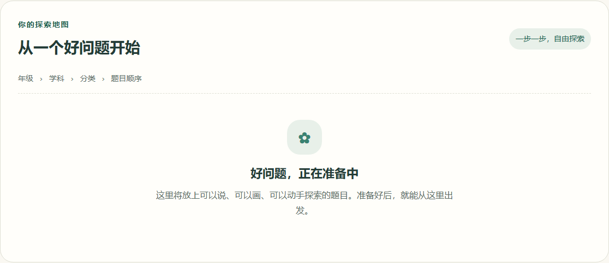
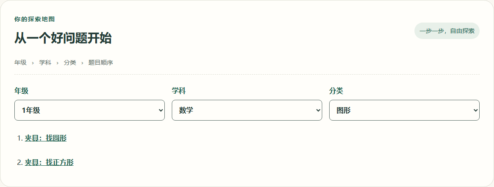
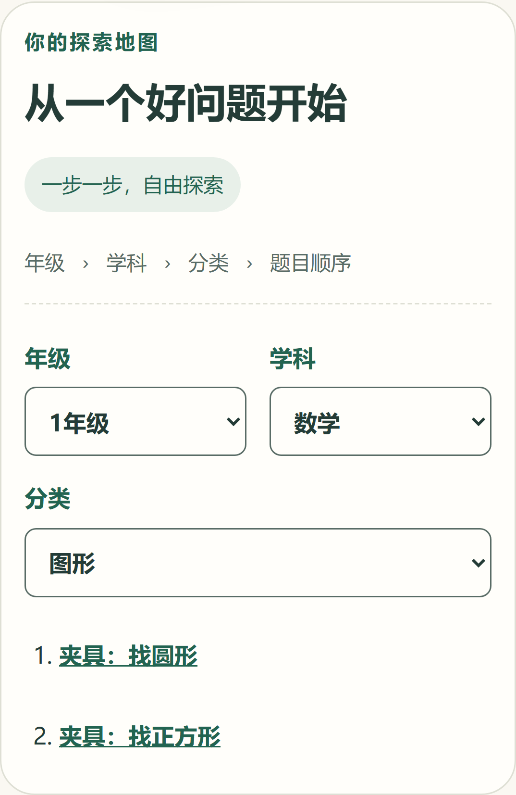

# #30 题库导航与版本接入

正式清单保持为空。桌面和手机浏览器用 Playwright 注入隔离的题库响应，显示年级、学科、分类和题目顺序，并验证切换分类、空分类、版本化链接和返回时的筛选恢复。历史版本打开和页面状态重置由独立组件夹具验证。

| 变更前                    | 变更后（桌面夹具）                 | 变更后（手机夹具）                |
| ------------------------- | ---------------------------------- | --------------------------------- |
|  |  |  |

## 接入题目

1. 在 `libs/problems/src/server.ts` 的正式注册表加入公开摘要和对应版本的服务端判定。题目 ID 用小写字母、数字和连字符，版本用正整数。改题时沿用 ID、增加版本号。
2. 在 `apps/web/src/features/library/pages/problem-pages.ts` 用 `problemPath(id, version)` 注册专属页面的渲染回调。页面接收该版本的公开摘要。保留旧版的服务端与页面注册项时，旧版链接可以继续打开。
3. `GET /api/v1/problems` 按年级、学科、分类、顺序及 ID 返回每题最新版本。可在正式注册表显式配置空分类；客户端按同一顺序呈现。`GET /api/v1/problems/:id/:version` 精确返回该版本的公开摘要。

生产浏览器构建扫描测试夹具和私有判定标记。额外用 Vite 验证浏览器直接导入 `@education/problems/server` 会被包导出规则拒绝。截图中的题目来自测试响应。
