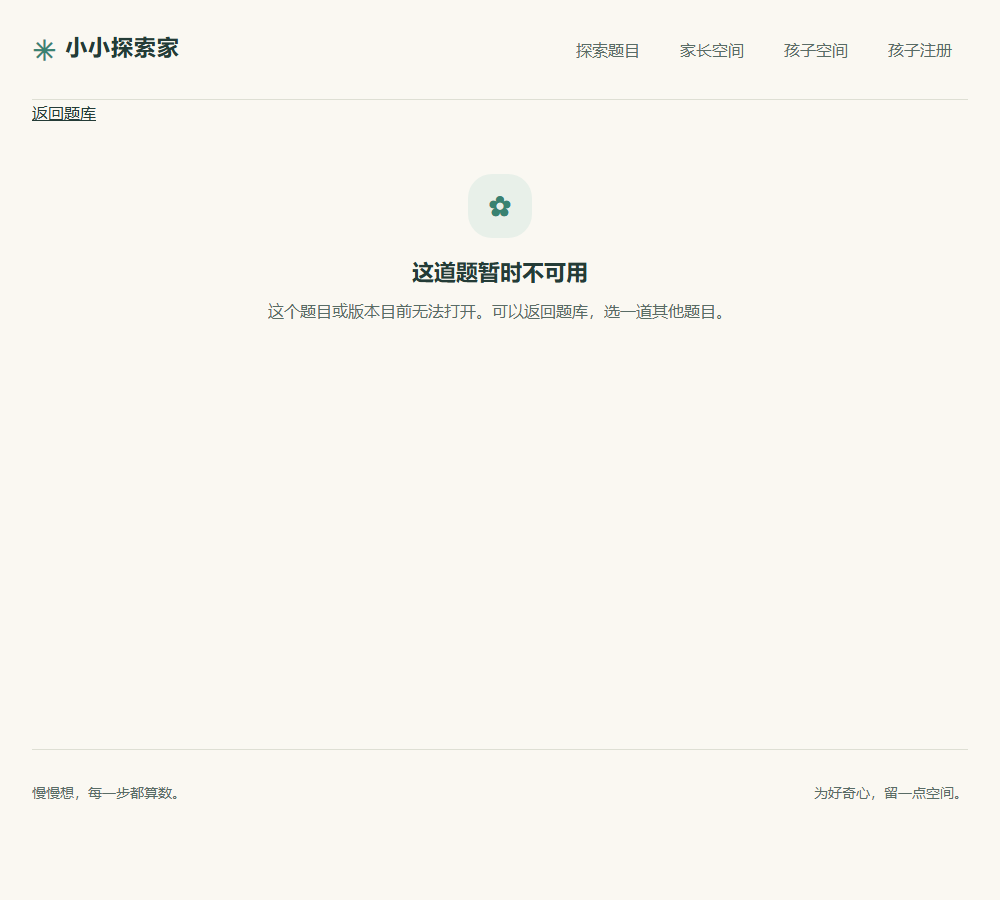
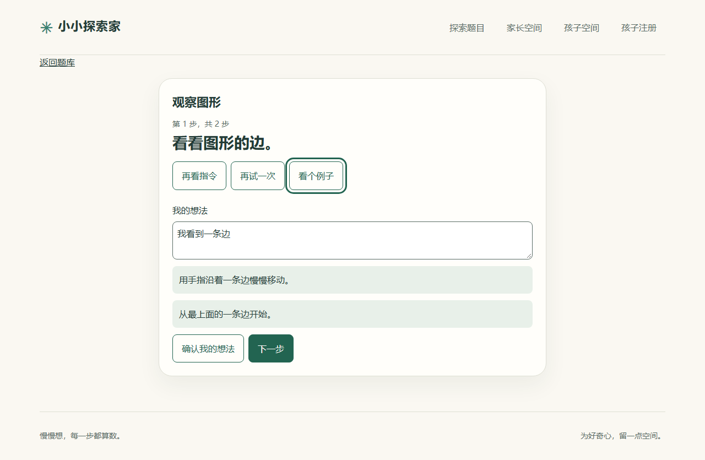
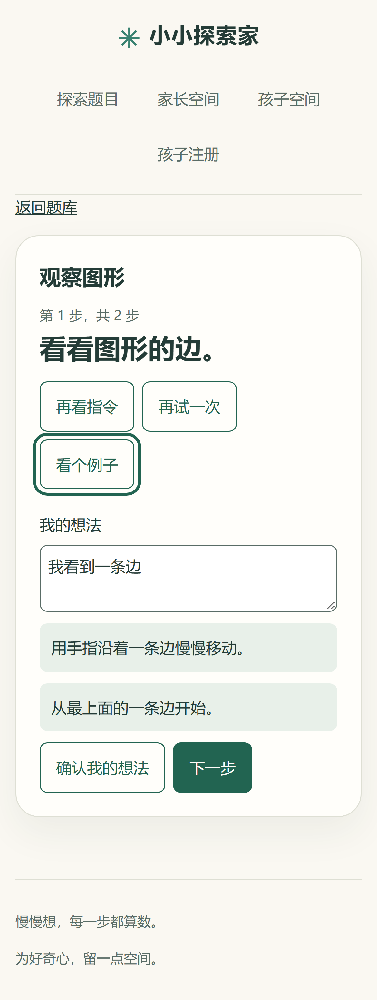

# #31 逐步教学验收

向服务端题目插件的 `teaching.steps` 提供有序步骤。每步有唯一 ID、一条指令、一次重试可用的具体做法、小提示和示范，也可以提供一个例子。题目详情只公开相应版本的这些字段。已注册的定制页面继续优先使用，私有 `checkStep` 留在服务端。

通用页面一次显示一个目标。重复查看、重试和逐级提示会记录为本次练习的帮助事件。输入在当前步骤内保留，确认文字后仍可能无法判断。继续和看完引导只改变页面步骤。正式朗读见 #42，草稿和作答记录见 #33、#34。

截图使用浏览器测试的隔离题目。生产题库仍为空。

| 改动前                        | 桌面端小提示                     | 移动端小提示                    |
| ----------------------------- | -------------------------------- | ------------------------------- |
|  |  |  |
