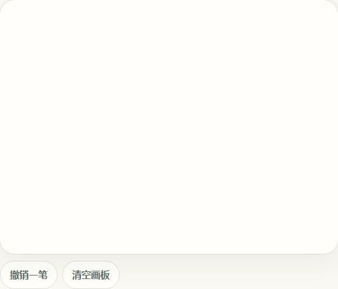
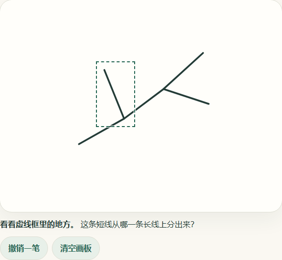

# #32 触摸画板与位置反馈

## 课堂接入

- 题目在需要孩子画草图、标记结构或表达思路的步骤嵌入 `DrawingBoard`，并提供该场景的中文标签与替代输入。画板由场景持有不可变的 `Drawing`，每次完整抬笔、撤销一笔或清空时收到新的快照。
- 笔迹和反馈位置使用同一张 4:3 画纸。坐标从左上角算起，横纵各用 0 到 1 的比例。显示尺寸变化时重新绘制，画布外仍可滚动。指针取消或意外失去捕获时放弃当前未完成笔画。
- 反馈使用 `TeachingFeedback` 和送去检查的原始 `Drawing` 引用。题目步骤或画图快照变化后，旧反馈自动隐藏。有效区域用虚线和中文提示标出。越界、识别失败或结果不确定时，请孩子确认或换一种方式。
- `exportInk` 按调用方显式请求导出独立 PNG，最大 1024 × 768 和 512 KiB。首次编码超限时尝试 512 × 384，空画或编码仍不合格时返回空值。文件只有白底和笔迹，方便后续服务对齐返回的区域。
- 组件在内存中处理输入。画板和 PNG 导出没有远端调用。草稿保存交 #33，绘图识别和结构化反馈交 #40，正式题目接入交 #49。

绘图实现沿用 [ADR-0012](../../adr/0012-browser-voice-touch-spike.md)。浏览器输入和图像编码的接口约定见 [W3C Pointer Events](https://www.w3.org/TR/pointerevents3/) 和 [MDN Canvas toBlob](https://developer.mozilla.org/en-US/docs/Web/API/HTMLCanvasElement/toBlob)。

## 验证

Storybook 提供空画板、区域反馈和请确认三种状态，使用叶脉笔迹作为测试夹具。打开 `npm run storybook` 后选择 `Learning / Drawing board`。

- Chromium 桌面用实际鼠标事件验证快画和慢画、键盘撤销、清空、编辑后隐藏旧标记，以及不确定状态。导出得到 1024 × 768、18,807 字节的 PNG。观察绘图、编辑与导出过程，未发现 fetch、XHR 或非 GET 请求。
- Chromium 模拟触摸用浏览器触摸事件验证落笔、抬笔和取消，确认取消当前笔画时保留上一笔。3× 像素密度下验证画板外滚动、1.5× 页面缩放和横竖屏切换，笔迹与标记保持对齐。
- 单元和组件测试覆盖无效范围、不确定反馈、快照失效、撤销清空、坐标换算和 PNG 超限后的缩小或拒绝。
- 本次触摸证据来自 Chromium 模拟。物理触屏与 iPad Safari 的正式验收仍需在 #51 中进行。

| 落笔前                 | 绘图及区域反馈                    |
| ---------------------- | --------------------------------- |
|  |  |
