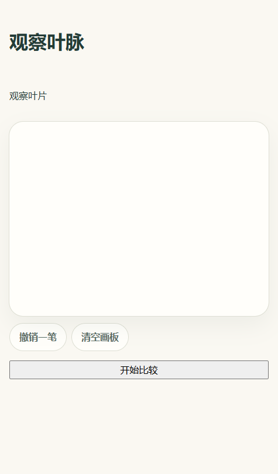
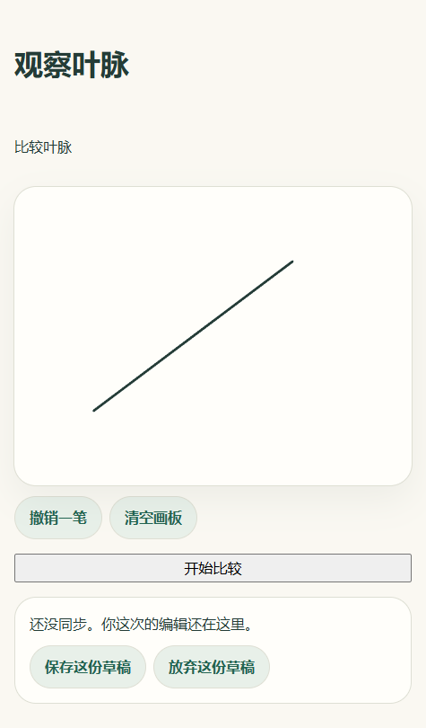
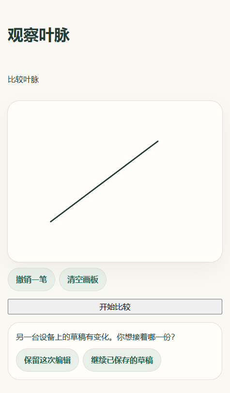

# #33 七天草稿

## 场景接入

- 每个已登录儿童在同一题目版本有一份草稿。场景用 `useLessonDraft` 恢复最近成功保存的 `stepId` 和 `DrawingBoard` 的归一化笔迹。用 `DraftNotice` 展示保存、未同步、重试和冲突选择。
- 保存由场景发起。断网或保存失败时保留当前页面的编辑，重连后可以重试。关闭页面前未成功保存的输入只在该页面内存中。当前编辑与迟到的保存响应分开处理。
- 两台设备从同一版本保存时，另一份会收到冲突。选择保留当前编辑后，下一次保存会按刚看到的远端版本比较。选择继续已保存的草稿会恢复远端步骤和笔迹。
- 保存体限制为 256 KiB。协议只接受步骤和笔迹坐标。读写绑定当前儿童会话和题目版本。未实际改变内容的保存不会延长有效期。
- 到期点为最后一次成功保存有效编辑后的 168 小时。读取时过期记录立即失效并删除，隔离 staging 的定期维护任务清理其他过期记录。放弃草稿也要匹配当前版本。
- `deleteDraftRevision` 在调用方的数据库事务里只删除指定儿童、题目和草稿版本。正式提交接入 #34，逐题接入 #49，部署更新前保存接入 #47。恢复旧备份的服务端数据世代切换由恢复流程处理，见 [ADR-0005](../../adr/0005-data-consistency.md)。

## 验证

- PostgreSQL 17 和两个 Fastify 实例验证并发写入、一份保存和一份 409、跨家庭隔离、七天边界、未读取过期记录的清理、放弃及事务回滚。请求验证覆盖登录失效、来源、CSRF、未知题目、越界坐标、原始音频字段和请求体超限。
- Chrome 使用两个独立浏览器会话连接真实 API 和 PostgreSQL。实际在画板上画线并断网，重连后收到 409，验证两种明确选择。刷新恢复步骤和笔迹，放弃后再次刷新确认画板为空且数据库记录已删除。
- 网页自动化测试覆盖断网重试、两种冲突处理、切换账号及保存中继续编辑。Storybook 中可打开 `Learning / Draft notice` 查看已保存、未同步、冲突和远端已失效状态。

截图来自只在本地运行的叶脉画板测试场景。它未加入正式题库。

| 开始编辑前                  | 断网保留笔迹                           | 重连后的版本冲突                    |
| --------------------------- | -------------------------------------- | ----------------------------------- |
|  |  |  |
