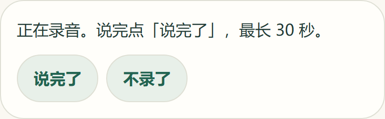
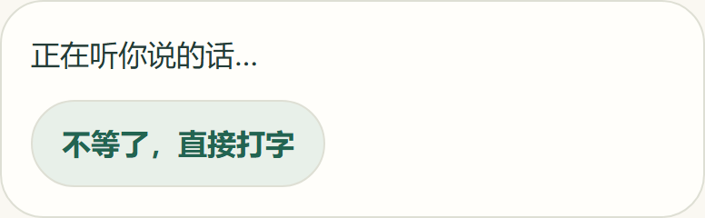
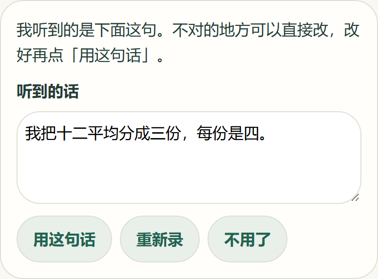
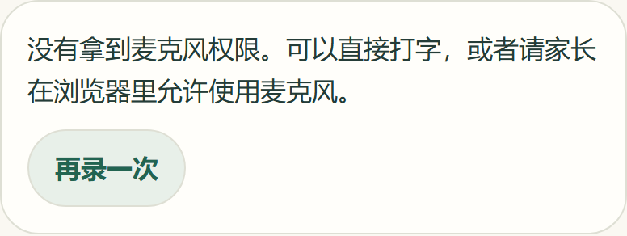
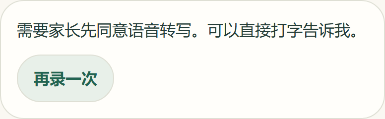

# 中文语音输入与识别确认

[#41](https://github.com/juanchaopan/education/issues/41) 让儿童在当前步骤用说的回答：主动录一段短录音，服务端转成文字，孩子检查、修改并确认后，这段文字才作为这一步的文字作答。对应 REQ-003、REQ-006、REQ-008，按 [ADR-0012](../../adr/0012-browser-voice-touch-spike.md) 的试点方案实现。

## 流程

`POST /api/v1/problems/:id/:version/transcription`，请求体为 `stepId`、`format`（`webm` 或 `mp4`）和录音的 base64，要求儿童会话、CSRF 和同源请求头。

1. 校验儿童会话；题目版本不存在，或这一步没有开放 AI 帮助时返回 404，不触达服务商。
2. 检查录音：解码后 64 B–256 KB，WebM 以 EBML 头开头，MP4 在第 4–8 字节是 `ftyp`。不符合时返回 `fallback: invalid-input`。
3. 经网关调用 OpenAI 文件转写：需要付费开关、密钥、部署资格 `OPENAI_TRANSCRIPTION_ELIGIBLE=true` 和家长当前版本的「语音转写」授权。授权「AI 解题提示」不能代替，政策版本更新后的旧授权也不能。沿用 #38/#39 的额度预留、10 秒超时和取消。
4. 上传内容只有录音、模型 `gpt-transcribe`、语言 `zh-cn`，以及题目作者为这一步写的关键词 `vocabulary`（作为识别提示，例如「平均分、每份」）。不含孩子的昵称、家庭、会话或题目说明。
5. 返回 `ready`（识别出的文字）、`unheard`（没有听到字）或 `fallback`（原因同 AI 提示）。转写从不记录作答、不改变进度，录音只在这次请求的内存里，不写入草稿、日志或数据库。

## 家长授权

「语音转写」的说明改为：孩子主动录下的一段不超过 30 秒的短录音，以及当前题目步骤里的几个关键词（只来自题目，不含孩子的信息）。政策版本从 20261106 升为 20261107，已经同意过旧版本的家庭需要重新同意，才能再次使用转写。

## 费用与限制

| 项目             | 规则                                                                                                                                                                                     |
| ---------------- | ---------------------------------------------------------------------------------------------------------------------------------------------------------------------------------------- |
| 时长             | 浏览器录到 30 秒自动停止。服务端不解码音频，无法验证时长                                                                                                                                 |
| 大小             | 解码后至多 256 KB。浏览器请求 32 kbit/s，30 秒约 120 KB，留出两倍码率的余量                                                                                                              |
| 预留             | 每次按 32 秒、US$0.0045/分钟预留 US$0.0024。这比反馈请求的 US$0.002176 大，所以家长页的预算状态按它判断                                                                                  |
| 结算             | 服务商报告 `usage: { type: 'duration', seconds }` 时按实际毫秒结算；报告其他形式或没有报告时保留预留金额                                                                                 |
| 超过 32 秒的录音 | 只可能来自绕过浏览器限制的客户端。按实际时长结算但不返回文字。不记为超界（`out-of-bounds`），否则一个孩子的上传就会让所有家庭本月停用付费 AI。月度上限照常生效：记账后余额不足时不再受理 |
| 退回预留         | 401、403 退回预留。其他错误保守地保留                                                                                                                                                    |
| 限流             | 与解题提示、反馈共用每儿童每分钟 6 次、每家庭每分钟 18 次                                                                                                                                |
| 识别文字         | 换行和控制字符换成空格，至多 500 字（同反馈文字上限）。超长视为识别失败                                                                                                                  |

## 浏览器

- **录音器** `voice/recorder.ts`：孩子点一下才申请麦克风。优先 `audio/webm;codecs=opus`，其次 `audio/webm`，再次 `audio/mp4`，都不支持时直接说明不能录音。
- **结束录音时**：孩子点「说完了」或到 30 秒时保留录音。点「不录了」、页面切到后台、麦克风轨道结束或录音器出错时丢弃录音。所有结束方式都立即释放麦克风。
- **申请授权期间**：麦克风授权回来之前孩子取消了，或页面已隐藏，就立即关闭拿到的麦克风。
- **请求** `transcription-request.ts`：超过 256 KB 或不符合共享 schema 的录音不离开浏览器，回复也按共享 schema 检查。
- **状态** `voice-input.ts` 和 `useVoiceInput`：复用 `createAiHelpRequest`，同一时间只有一个请求。识别慢时孩子可以点「不等了，直接打字」，迟到的结果被忽略。课程关闭时取消请求并释放麦克风。
- **面板** `VoiceInputPanel`：识别出的文字放在普通文本框里，可以改，不按 HTML 渲染。只有非空、经孩子点「用这句话」确认的文字才交给页面。
- **出错时**：没听清、麦克风被拒、设备不能录、需要家长授权、超时或失败，都用中文说明，并提示可以直接打字；设备不能录时不显示「再录一次」。

| 等待开始                            | 正在录音                                | 正在识别                                   |
| ----------------------------------- | --------------------------------------- | ------------------------------------------ |
|  |  |  |

| 检查和修改                             | 麦克风被拒                                        | 需要家长授权                                           |
| -------------------------------------- | ------------------------------------------------- | ------------------------------------------------------ |
|  |  |  |

截图来自 Storybook 静态构建，Windows 无头 Chromium，宽 420 px、DPR 2。

## 自动化检查

- **领域**：容器签名、大小上限、按毫秒计费与浮点取整、超长录音、未知用量、识别文字清理、关键词裁剪；预算状态取最大预留。
- **网关**：multipart 字段与文件名，WebM 与 MP4；未配置时不申请授权也不上传；401 退回预留；非 JSON、坏 JSON、超长回复、超长文字都按不可用处理；超时取消上传。
- **服务与路由**：会话先于一切检查；未开放的步骤和继承属性名返回 404；容器不符不上传；请求体限制、未知字段、同源与 JSON 头；没有配置服务时返回 503。
- **数据库集成**（`voice-transcription.integration.ts`）：只有「AI 解题提示」授权时不上传；旧政策版本的授权不上传；只上传录音和关键词，按实际时长结算、`model` 为 `gpt-transcribe`、token 列为空，不产生作答记录；没听到字时仍按实际时长结算。
- **前端**：录音格式选择、码率、30 秒自动停止、取消、后台切换、轨道结束、录音器出错、授权回来前取消、隐藏时授权回来、空录音；请求编码与回复校验；状态机的确认、修改、清空、没听清、授权失败、网络失败、改为打字后忽略迟到结果、关闭时释放；面板各状态。

## 未验证

- 没有真实 OpenAI 调用。`prompt` 参数是否被 `gpt-transcribe` 接受、关键词对识别是否有帮助、实际返回的用量格式，都待首批真实题目接入时复测。#28 已用同一模型、同一语言参数验证 WebM 和 M4A 转写，但没有带 `prompt`。
- 没有真机录音。iPad Safari、iPhone、Android 的实际 MIME、码率、后台切换和权限提示，以及儿童真实语音、噪声中的识别准确度，按 ADR-0012 交 [#51](https://github.com/juanchaopan/education/issues/51) 验收。
- 题库为空，没有页面挂载语音面板，确认的文字交给哪个作答框由首批真实题目的页面决定。面板目前只在 Storybook 和单元测试中展示。
- 数据库集成测试需要隔离的 `education_test` 库，运行结果以 CI 为准。
