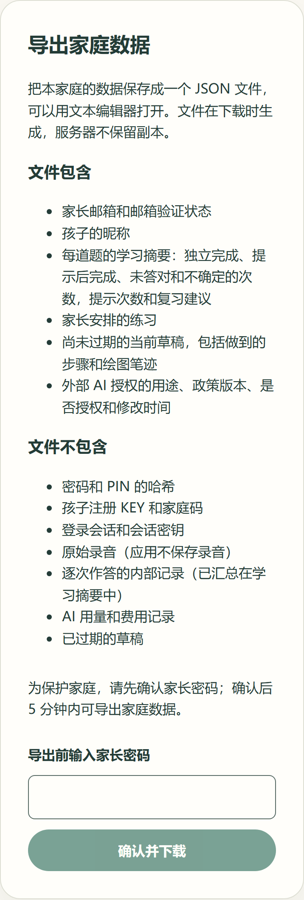
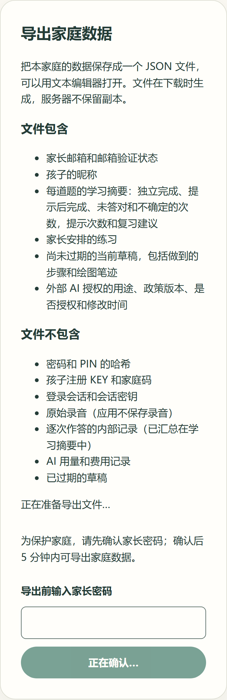
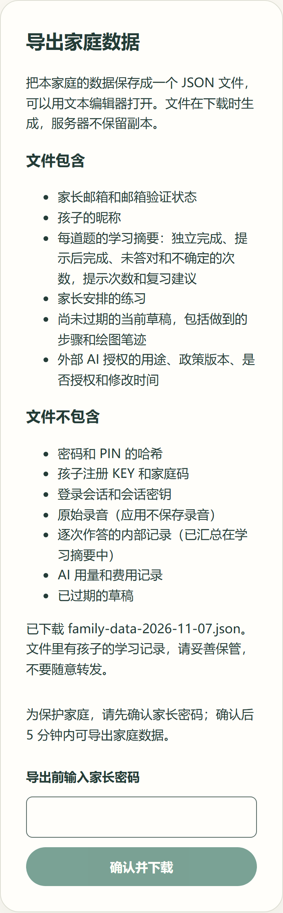
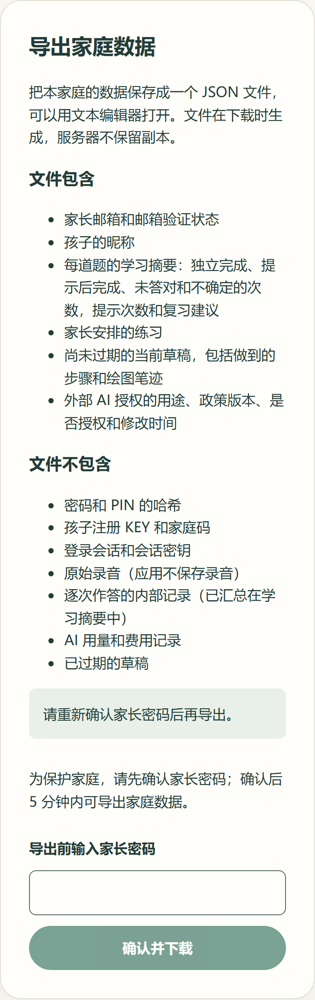

# 家长导出本家庭数据

[#43](https://github.com/juanchaopan/education/issues/43) 让家长在确认密码后，把本家庭的数据下载为一个 JSON 文件。对应 REQ-005、REQ-009，按 [ADR-0009](../../adr/0009-account-security-spike.md) 的近期密码确认和 [ADR-0005](../../adr/0005-data-consistency.md) 的家庭范围处理。

## 文件的格式和范围

- 格式：一个 UTF-8 JSON 文件，可以用文本编辑器打开。文件开头的 `format` 写明格式名 `education-family-export`、版本 `1`、生成时间，以及下面两张清单，所以文件离开家长空间后仍能说明自己。
- 包含：家长邮箱和邮箱验证状态；孩子的昵称；每道题的学习摘要（独立完成、提示后完成、未答对和不确定的次数，提示次数和复习建议）；家长安排的练习；尚未过期的当前草稿，包括做到的步骤和绘图笔迹；外部 AI 授权的用途、政策版本、是否授权和修改时间。
- 不包含：密码和 PIN 的哈希；孩子注册 KEY 和家庭码；登录会话和会话密钥；原始录音（应用不保存录音）；逐次作答的内部记录（已汇总在学习摘要中）；AI 用量和费用记录；已过期的草稿。内部编号也不导出，孩子按昵称区分。
- 两张清单写在共享协议 `familyExportScope` 里，页面说明和文件内容用的是同一份。

## 授权和数据安全

| 情况                                   | 结果                                                                                       |
| -------------------------------------- | ------------------------------------------------------------------------------------------ |
| 家长每次导出                           | 先确认家长密码。确认会更新会话，导出请求用更新后的会话发出                                 |
| 密码确认已超过 5 分钟                  | 拒绝导出（403），不读取任何数据                                                            |
| 密码错误                               | 不发出导出请求                                                                             |
| 其他网站发起的请求                     | 同源、请求头和 CSRF 检查不通过时拒绝，不读取家庭                                           |
| 导出等待期间会话被撤销或家长密码被重置 | 导出在锁住家庭和会话的同一个事务里完成，锁释放后会话已失效，返回 401，不给出数据           |
| 家庭已删除                             | 会话随家庭一起失效，返回 401                                                               |
| 服务端误读出协议外的字段               | 响应按协议序列化，协议没有声明的字段（例如哈希、内部编号）不会出现在文件里                 |
| 缓存                                   | 响应是 `Cache-Control: no-store`，服务器不生成也不保存导出文件，没有需要清理的服务端副本   |
| 浏览器保存                             | 先校验收到的是完整的导出文件再保存；拒绝或不完整的响应不保存。下载链接的内存在 10 秒后释放 |
| 空家庭                                 | 正常导出，孩子和授权列表为空                                                               |

## 组成

- **共享协议** `libs/contracts/src/family-export.ts`：`FamilyExport` 是文件结构，也是服务端的字段白名单。
- **接口** `POST /api/v1/parents/family-export`：请求体为空对象，成功时以附件返回文件。
- **身份** `identity/services/family-export.ts`：在家长会话事务里检查近期密码确认，读取家庭的孩子和 AI 授权，逐个孩子组合学习记录。
- **学习** `learning/services/child-learning-export.ts`：在同一事务里读取一个孩子的全部学习摘要、练习和仍可恢复的草稿。格式已不符合草稿协议的内容不导出。
- **家长空间** `FamilyExportPanel`：说明文件格式和范围，确认密码后直接下载 `family-data-<日期>.json`。

| 等待确认密码                                        | 正在准备                                 | 已下载                             | 失败                              |
| --------------------------------------------------- | ---------------------------------------- | ---------------------------------- | --------------------------------- |
|  |  |  |  |

截图来自 Storybook 静态构建，Windows 无头 Chromium，宽 390 px、DPR 2。

## 自动化检查

- **服务**：没有近期密码确认时不读取任何数据；文件只含登录家庭的数据并写明格式与范围；空家庭可以导出。
- **接口**：附件、`no-store` 和 `Vary: Cookie`；服务返回协议外字段时被丢弃；其他网站的请求在读取前被拒绝；拒绝和服务未配置时返回不带附件头的错误信息。
- **真实数据库**（CI 的 `test:db`）：两个家庭互不可见；过期草稿和格式不符的草稿不导出；文件中没有密码、PIN 和 KEY 的哈希、会话令牌、家庭码和孩子编号；密码确认超过 5 分钟时拒绝；导出等待家庭锁期间家庭重置会话，提交后返回 401；家庭删除后返回 401；没有孩子的家庭可以导出。
- **页面**：先说明范围；确认密码后用更新后的会话下载；密码错误不请求文件；拒绝或不完整的响应不保存；下载后释放内存。

## 未验证

- 没有在真机上下载。iPhone、iPad 和 Android 浏览器的保存位置和文件打开方式交 [#51](https://github.com/juanchaopan/education/issues/51) 验收。
- 题库为空，学习摘要、练习和草稿中的题目名称在正式题目接入前为空值。
- 家庭删除由 [#44](https://github.com/juanchaopan/education/issues/44) 实现；导出不生成服务端文件，删除时没有导出副本需要清理。
