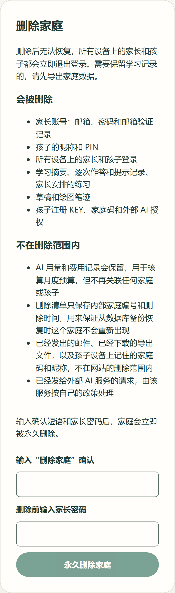
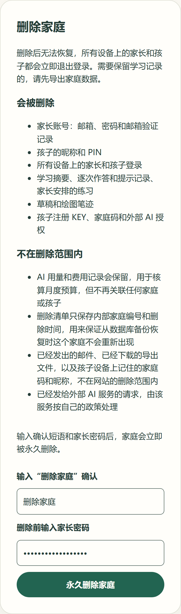
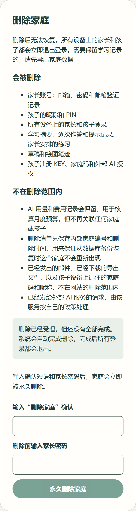
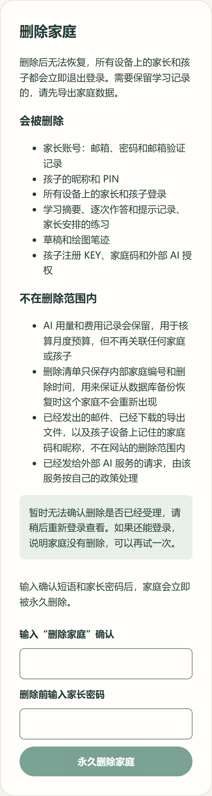
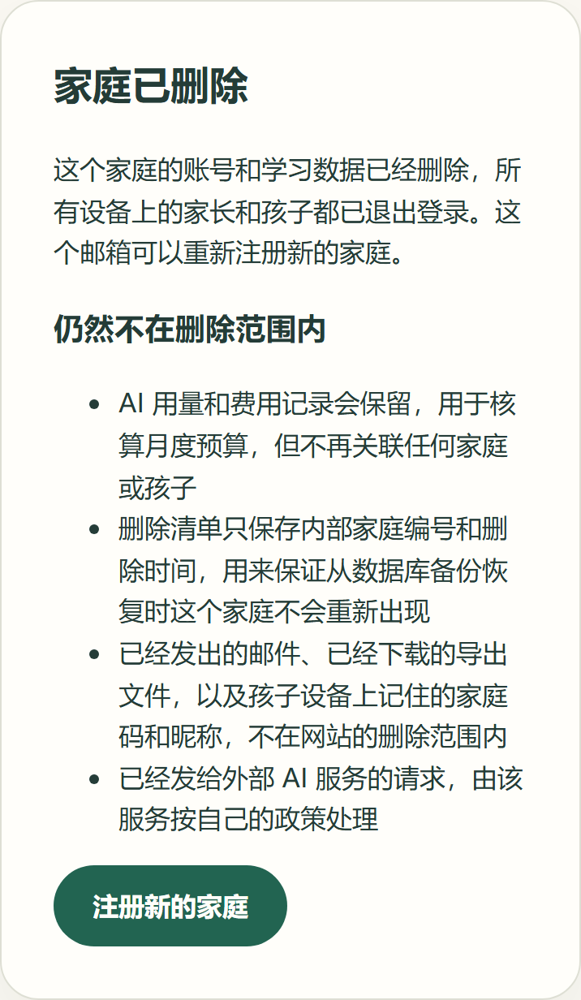

# 家庭删除与即时访问撤销

[#44](https://github.com/juanchaopan/education/issues/44) 让家长在确认密码并输入“删除家庭”后删除整个家庭。对应 REQ-002、REQ-005、REQ-009，按 [ADR-0005](../../adr/0005-data-consistency.md) 的家庭删除试点目标实现。删除清单放在独立数据库里，这是维护者在开工前选定的方案。

## 删除什么，留下什么

删除 `families` 一行，经外键级联删掉：

- 家长账号、邮箱验证和密码恢复记录
- 孩子，以及所有家长和孩子的登录会话
- 学习摘要、逐次作答和提示记录、练习安排
- 草稿和绘图笔迹
- 注册 KEY、家庭码和外部 AI 授权

导出文件从不保存在服务器上，删除时没有导出副本需要清理。

留下的内容，以及原因：

| 内容                         | 原因和处理                                                                                                                                                                  |
| ---------------------------- | --------------------------------------------------------------------------------------------------------------------------------------------------------------------------- |
| AI 用量和费用记录            | 月度预算要按实际费用核算。记录保留模型、时间、token 和金额，家庭和孩子编号被置空                                                                                            |
| 删除清单                     | 只有内部家庭编号、受理和完成时间、顺序，放在独立的清单库里。从旧备份恢复时用它再次删除这个家庭（恢复流程由 [#45](https://github.com/juanchaopan/education/issues/45) 演练） |
| 已发出的验证和密码恢复邮件   | 在收件人的邮箱里，也在发信 Gmail 账号的已发送邮件里，不在网站的删除范围内                                                                                                   |
| 已下载的导出文件             | 在家长自己的设备上                                                                                                                                                          |
| 孩子设备上记住的家庭码和昵称 | 存在该设备的浏览器里，可以在孩子登录页取消记住。家庭删除后家庭码不再能登录                                                                                                  |
| 已发给外部 AI 服务的请求     | 请求设置为不由服务方存储（`store: false`），但服务方是否以及保留多久按其当前条款处理，正式上线前需按供应商条款核实                                                          |

页面在删除前列出这两部分，删除后再提醒一次留下的内容。两份清单写在共享协议 `familyDeletionScope` 里。

## 授权、撤销和失败处理

| 情况                            | 结果                                                                                                                                        |
| ------------------------------- | ------------------------------------------------------------------------------------------------------------------------------------------- |
| 家长每次删除                    | 先输入“删除家庭”，再确认家长密码；确认会更新会话，删除请求用更新后的会话发出                                                                |
| 短语不对                        | 按钮保持不可用；接口返回 422，不写清单、不删除                                                                                              |
| 密码确认已超过 5 分钟           | 返回 403，不写清单、不删除                                                                                                                  |
| 删除成功                        | 在锁住家长、家庭和会话的事务里先写清单，再删除家庭，然后提交。提交后任何实例都不再接受这个家庭的会话；页面显示“家庭已删除”并清除登录 cookie |
| 其他请求同时在等这个家庭        | 家长请求排在删除之后，删除提交后得到 401，不会死锁；孩子请求同样被拒绝                                                                      |
| 重复删除                        | 第二个请求的会话已不存在，返回 401                                                                                                          |
| AI 请求已发出、回复晚于删除到达 | 回复读取后会再确认孩子的会话和家庭授权，会话不存在时不返回内容，只记下费用                                                                  |
| 清单库写入失败或结果不确定      | 家庭保留，返回 503，并告诉家长：重新登录查看，如果还能登录说明没有删除，可以再试                                                            |
| 写入清单后事务失败              | 单独重试一次删除；成功则正常完成                                                                                                            |
| 重试仍失败                      | 返回 202“处理中”并记日志，页面说明删除已受理、还没有全部完成。维护命令按受理顺序完成，删不掉的跳过并计数，下次重试                          |
| 没有配置清单库                  | 不提供删除，接口返回 503                                                                                                                    |

所有家长事务的家长行锁为 `FOR NO KEY UPDATE`。家长请求原本就在随后的家庭排他锁上串行，这样删除家长行时不会和其他家长请求互相等待；引用家长的外键检查和插入不受影响。

## 删除时限

正常情况下，删除在家长的一次请求里同步完成，在线数据立即清除。只有数据库在删除时出错，删除才会处于“处理中”。staging 每小时运行一次的维护任务会完成这些删除，满足 ADR-0005 “24 小时内完成在线数据清理”的试点目标。数据库备份的保留与恢复时重放清单由 #45 演练。

## 组成

- **清单库**：迁移在 `apps/api/drizzle-ledger`，表 `family_deletions`，开启 RLS 且没有策略。连接串为 `DELETION_LEDGER_URL`，托管环境的证书为 `DELETION_LEDGER_CA_CERT`，必须指向与应用库不同的数据库，否则启动时报错。
- **接口** `POST /api/v1/parents/family-deletion`：请求体 `{ "confirmation": "删除家庭" }`；成功 200 `{ "status": "deleted" }`，处理中 202 `{ "status": "pending" }`。
- **身份** `identity/services/family-deletion.ts`：写清单、删除、重试、完成；`completePending` 供维护任务使用。
- **AI** `ai/services/metered-call.ts`：每次付费调用在回复读取后再确认一次会话和授权。
- **维护命令** `npm run db:complete-deletions -w @education/api`（部署后为 `node dist/complete-deletions.js`）。staging 的每小时任务 `staging-mail-retention` 在配置了清单库时同时运行。
- **家长空间** `FamilyDeletionPanel`：说明范围，输入短语和密码后删除；删除完成后显示 `FamilyDeleted`。

| 未输入短语                                       | 可以删除                               | 处理中                                  | 失败                                | 删除后                              |
| ------------------------------------------------ | -------------------------------------- | --------------------------------------- | ----------------------------------- | ----------------------------------- |
|  |  |  |  |  |

截图来自 Storybook 静态构建，Windows 无头 Chromium，宽 390 px、DPR 2。

## 自动化检查

- **服务**：写清单、删除、提交、标记完成的顺序；短语错误或密码确认过期时不写清单；清单写入失败时不删除；事务失败后单独重试；两次失败返回处理中；只有标记完成失败时仍算已删除；维护按顺序完成并跳过失败的家庭。
- **接口**：成功清除 cookie；处理中返回 202 并保留会话；其他网站和多余字段的请求在删除前被拒绝。
- **AI**：会话在回复到达前失效时不返回内容，费用照常结算。
- **真实数据库**（CI 的 `test:db`）：
  - 用两个独立连接池模拟两个实例，只删本家庭的全部数据，两个实例上的家长和孩子旧会话都失效
  - 清单记为完成，AI 费用总额不变，其他家庭不受影响
  - 短语错误或密码确认过期时不写清单、不删除
  - 家长请求排在删除之后，不死锁并得到 401
  - 单独重试成功
  - 两次失败时返回处理中，维护命令完成，重复执行不改变结果
  - 清单库不可达时家庭保留
  - AI 回复晚于删除时不返回内容
- **页面**：先说明范围；短语完全一致前按钮不可用；用更新后的会话删除并退出登录；处理中和服务端说明的显示；密码错误时不发删除请求。
- **浏览器**（CI 的 `test:e2e`）：输入短语和密码后删除，页面显示“家庭已删除”，数据库中家庭已删除、清单已完成，刷新后回到未登录状态。
- **配置**：清单库与应用库相同时拒绝启动；同一 Supabase 连接池后的不同项目按用户区分；staging 的清单库须使用 `verify-full`。

## 未验证

- staging 还没有清单库。维护者需要新建一个独立的数据库（例如另一个 Supabase 项目），并在 GitHub Actions secrets 设置 `STAGING_DELETION_LEDGER_URL` 和 `STAGING_DELETION_LEDGER_CA_CERT`，见 [staging 文档](../../deployment/staging.md#44-家庭删除清单库)。设置前 staging 不提供删除。
- 生产的清单库位置、权限、防篡改和告警，以及从备份恢复时重放清单，由 #45 和部署设计确定。
- 外部 AI 服务和 Gmail 的实际保留期限没有在本 issue 中核实。
- 没有在真机上操作，交 [#51](https://github.com/juanchaopan/education/issues/51) 验收。
